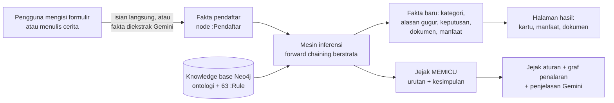
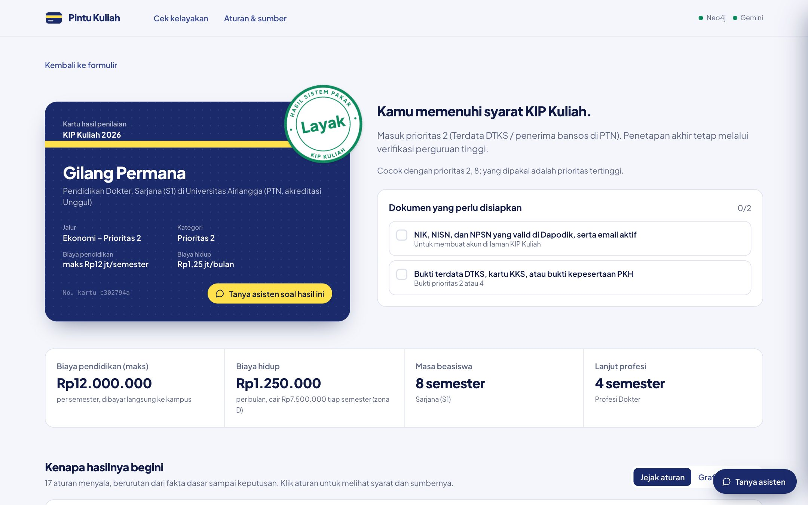
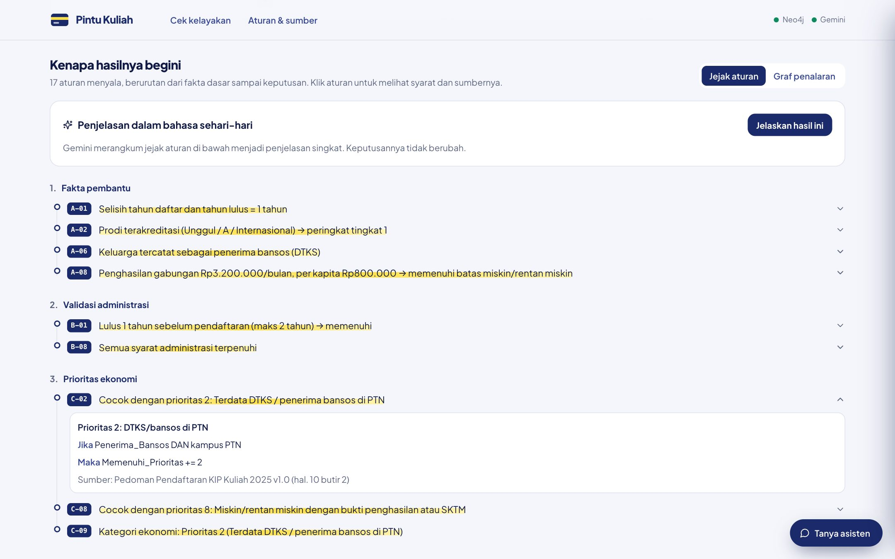
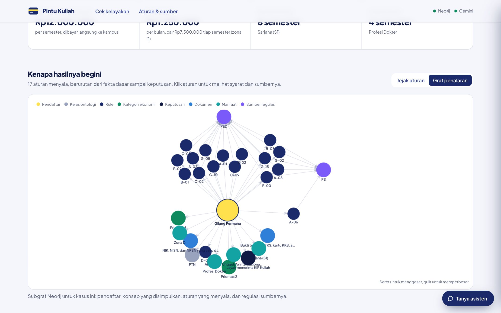
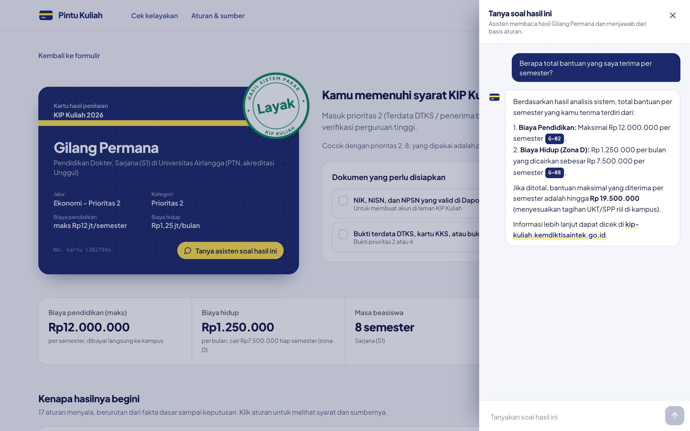

# Pintu Kuliah: Sistem Pakar Kelayakan KIP Kuliah

Proyek akhir mata kuliah Sistem Pakar Lanjut (MIK226410), Magister Kecerdasan Artifisial, Universitas Gadjah Mada.

**Aplikasi (demo publik): https://pintu-kuliah.vercel.app**

## Anggota kelompok

| Nama | NIM |
|---|---|
| Rafel Romero Hirawanto | 25/573260/PPA/07216 |
| Made Garda Setiawan | 25/573702/PPA/07218 |
| Taufik Nurrizqi | 25/573844/PPA/07225 |
| Muhammad Amridhan Mahdi | 25/575124/PPA/07270 |

Dosen pengampu: Dr. techn. Kabul Kurniawan, S.Kom., M.Cs.

## Resource

| Resource | Lokasi |
|---|---|
| Aplikasi yang didemokan | https://pintu-kuliah.vercel.app |
| T-Box (Turtle dan RDF/XML) | [docs/ontologi/tbox.ttl](docs/ontologi/tbox.ttl), [docs/ontologi/tbox.rdf](docs/ontologi/tbox.rdf) |
| A-Box (Turtle dan RDF/XML) | [docs/ontologi/abox.ttl](docs/ontologi/abox.ttl), [docs/ontologi/abox.rdf](docs/ontologi/abox.rdf) |
| Apps | [backend/](backend/) (FastAPI + mesin inferensi), [frontend/](frontend/) (React), [api/](api/) + [vercel.json](vercel.json) (deploy) |
| Basis aturan (63 aturan IF–THEN) | [backend/app/rules.py](backend/app/rules.py), rancangan: [Expert Project /Rules-Revisi.md](Expert%20Project%20/Rules-Revisi.md) |
| Sumber pengetahuan (regulasi) | [Pedoman Pendaftaran KIP Kuliah 2025](Expert%20Project%20/Pedoman-Pendaftaran-KIP-Kuliah-2025-v1-0_6fab51.pdf), [Persesjen Kemendikbudristek No. 13/2023](Expert%20Project%20/PERSESJEN-KEMENDIKBUDRISTEK-NOMOR-13-TAHUN-2023.pdf) |
| Dokumentasi lengkap | [docs/PANDUAN.md](docs/PANDUAN.md) ([PDF](docs/PANDUAN.pdf)): cara menjalankan, cara pakai, membaca hasil dan data Neo4j, kaitan dengan teori RDFS dan forward chaining |

A-Box adalah snapshot hasil ekspor dari Neo4j; tidak otomatis mengikuti isi database. Skrip pendukung ontologi:

```bash
uv run --directory backend --with rdflib python ../docs/ontologi/ekspor_abox.py   # ekspor ulang A-Box dari Neo4j
uv run --with rdflib python docs/ontologi/ke_rdfxml.py                            # buat ulang versi .rdf
uv run --with rdflib --with owlrl python docs/ontologi/validasi.py                # cek domain/range + closure RDFS
```

## 1. Deskripsi

KIP Kuliah adalah bantuan pemerintah untuk calon mahasiswa dari keluarga tidak mampu. Syaratnya tersebar di beberapa dokumen regulasi dan memiliki urutan prioritas, pengecualian, serta besaran manfaat yang berbeda-beda, sehingga sulit diperiksa sendiri oleh calon pendaftar.

Pintu Kuliah adalah sistem pakar berbasis knowledge graph yang menilai apakah seorang calon mahasiswa layak menerima KIP Kuliah. Dari data pendaftar, sistem menyimpulkan:

- keputusan **layak / tidak layak**, beserta alasan gugur bila tidak layak;
- **jalur** kelayakan: kategori prioritas ekonomi (Prioritas 1–8) atau pertimbangan khusus (afirmasi);
- **dokumen** yang wajib disiapkan;
- **manfaat**: batas biaya pendidikan per semester, biaya hidup sesuai zona, dan masa beasiswa sesuai jenjang/profesi.

Setiap kesimpulan disertai **jejak aturan** (aturan mana yang menyala, dalam urutan apa) dan **sumber regulasinya**.

| Komponen wajib | Implementasi |
|---|---|
| Knowledge representation: ontologi dan KG domain | Ontologi KIP Kuliah di **Neo4j** (property graph): 19 kelas dalam hierarki `SUBKELAS_DARI`, instance referensi (kategori ekonomi, kondisi khusus, alasan gugur, dokumen, biaya pendidikan, zona biaya hidup, jenjang, program profesi, sumber). Padanan RDF/RDFS tersedia sebagai T-Box dan A-Box |
| Rules IF–THEN dari pakar / sumber pengetahuan | **63 aturan** dalam 7 lapis (A–G) yang disusun dari Pedoman Pendaftaran KIP Kuliah 2025 dan Persesjen Kemendikbudristek No. 13/2023 (dasar hukum: Permendikbud No. 10/2020). Setiap aturan mencantumkan dokumen dan bagian yang dirujuk; 6 aturan turunan/negasi diberi keterangan asal |
| Reasoning / inferensi + penjelasan | **Forward chaining berstrata** sampai fixpoint. Setiap aturan yang menyala meninggalkan relasi `(:Pendaftar)-[:MEMICU {urutan, kesimpulan}]->(:Rule)` sebagai jejak penjelasan |
| Metode tambahan (LLM) | **Gemini**: mengisi formulir dari cerita bebas, menjelaskan jejak aturan dalam bahasa sehari-hari, dan asisten tanya-jawab yang berpijak pada basis aturan. LLM tidak pernah mengambil keputusan; sistem pakar tetap inti |

## 2. Cara kerja (workflow)



1. **Knowledge base.** Saat aplikasi start, ontologi (kelas + instance referensi) dan 63 aturan dimuat ke Neo4j ([ontology.py](backend/app/ontology.py)). Setiap aturan disimpan sebagai node `:Rule` yang terhubung ke sumber regulasinya (`BERDASARKAN`) dan konsep yang disimpulkannya (`MENYIMPULKAN`).
2. **Working memory.** Isian formulir disimpan sebagai node `:Pendaftar` dengan properti fakta (tahun lulus, jenis kampus, akreditasi, data bansos, penghasilan, kondisi khusus, dan lainnya). Fakta juga bisa diisi dari cerita bebas: Gemini mengekstraknya, lalu pengguna memeriksa sebelum menilai.
3. **Inferensi.** Setiap aturan adalah query Cypher: bagian IF menjadi `WHERE`, bagian THEN menjadi `SET`/`MERGE` ([rules.py](backend/app/rules.py)). Mesin inferensi ([engine.py](backend/app/engine.py)) menjalankan aturan per strata sampai tidak ada aturan baru yang menyala (fixpoint). Stratifikasi diperlukan karena ada negasi (*negation as failure*, mis. C-10 "tidak ada prioritas yang cocok") dan agregat `MIN` (C-09 memilih prioritas tertinggi).

   | Lapis | Isi | Contoh |
   |---|---|---|
   | A | Fakta pembantu | A-01 selisih tahun lulus, A-08 penerima bansos |
   | B | Validasi administrasi | B-02 lulus lebih dari 2 tahun, B-06 kelas eksekutif/karyawan |
   | C | Prioritas ekonomi | C-01 KIP SMA di PTN … C-08 miskin terbukti, C-09 tetapkan kategori |
   | D | Kondisi khusus | D-01 3T, Papua, bencana, dan lainnya |
   | E | Keputusan akhir | E-02 layak jalur ekonomi, E-03 layak pertimbangan khusus |
   | F | Dokumen wajib | F-01 kartu KIP SMA, F-06 SKTM |
   | G | Besaran manfaat | G-01 batas UKT, G-10 biaya hidup per zona, G-15 profesi dokter |

4. **Penjelasan.** Setiap aturan yang menyala dicatat sebagai relasi `MEMICU` dengan urutan dan kalimat kesimpulannya. Halaman hasil menampilkan jejak ini per lapis, lengkap dengan bagian JIKA/MAKA dan sumber regulasinya, serta subgraf Neo4j kasus tersebut. Gemini dapat menceritakan ulang jejak ini dengan bahasa sehari-hari; asisten tanya-jawab hanya menjawab dari aturan yang ada dan mengutip ID aturannya.
5. **Representasi RDF.** Ontologi yang sama tersedia sebagai T-Box/A-Box RDF dan divalidasi terhadap aturan entailment RDFS (rdfs2, rdfs3, rdfs7, rdfs9, rdfs11). Penjelasan lengkap ada di [PANDUAN bagian 6](docs/PANDUAN.md#6-kaitan-dengan-teori).

## 3. Hasil

### Pengujian 10 kasus

Sepuluh profil uji mencakup semua jalur keputusan. Semua profil bisa dicoba di aplikasi lewat **Beranda → Coba dengan profil contoh**.

| Kasus | Profil | Keputusan | Jalur | Aturan yang menyala |
|---|---|---|---|---|
| T1 | Rina, KIP SMA di PTN | Layak | Ekonomi – Prioritas 1 | A-01 A-02 A-08 B-01 C-01 C-08 B-08 C-09 D-02 E-02 F-00 F-01 G-01 G-07 G-10 |
| T2 | Bayu, KIP SMA di PTS, prodi B | Layak | Ekonomi – Prioritas 3 | A-01 A-03 B-01 C-03 B-08 C-09 D-02 E-02 F-00 F-01 G-03 G-07 G-10 |
| T3 | Yohana, orang asli Papua | Layak | Pertimbangan khusus | A-01 A-02 B-01 D-01 B-08 C-10 E-03 F-00 F-09 G-01 G-09 G-10 |
| T4 | Dimas, kelas karyawan + KKS | Tidak layak | Gugur administrasi (B-06) | A-01 A-02 A-06 B-01 B-06 C-02 B-09 C-09 D-02 E-01 |
| T5 | Salsa, penerima beasiswa APBD | Tidak layak | Gugur administrasi (B-07) | A-01 A-02 B-01 B-07 C-01 B-09 C-09 D-02 E-01 |
| T6 | Arif, tahun lulus 2027 | Tidak layak | Gugur administrasi (B-03) | A-01 A-02 B-03 B-09 C-10 D-02 E-01 |
| T7 | Nanda, SKTM di PTS | Layak | Ekonomi – Prioritas 8 | A-01 A-03 A-09 B-01 C-08 B-08 C-09 D-02 E-02 F-00 F-06 G-03 G-07 G-10 |
| T8 | Fajar, P3KE desil 2 + panti | Layak | Ekonomi – Prioritas 5 | A-01 A-02 A-07 A-08 B-01 C-05 C-07 C-08 B-08 C-09 D-02 E-02 F-00 F-03 G-01 G-07 G-10 |
| T9 | Putri, lulus 2022 | Tidak layak | Gugur administrasi (B-02) | A-01 A-02 B-02 C-01 B-09 C-09 D-02 E-01 |
| T10 | Gilang, calon dokter + DTKS | Layak | Ekonomi – Prioritas 2 | A-01 A-02 A-06 A-08 B-01 C-02 C-08 B-08 C-09 D-02 E-02 F-00 F-02 G-02 G-08 G-10 G-15 |

Kesepuluh kasus memberi keputusan yang sesuai harapan, baik di lingkungan lokal maupun di aplikasi publik (3–6 detik per penilaian).

Contoh membaca jejak (T10, Gilang): fakta DTKS membuat A-08 menyimpulkan *penerima bansos*; C-02 mencocokkan Prioritas 2 (bansos di PTN), C-08 mencocokkan Prioritas 8; C-09 memilih prioritas tertinggi (2); E-02 memutuskan *layak jalur ekonomi*; lapis F dan G menurunkan dokumen DTKS, batas UKT kedokteran, biaya hidup zona D, dan masa profesi dokter.

### Validasi ontologi

- T-Box 342 triple, A-Box 3.078 triple; semua predikat A-Box dideklarasikan di T-Box dan tidak ada pelanggaran domain/range (rdfs2/rdfs3).
- Closure RDFS (owlrl) menurunkan tipe `Entitas` untuk setiap pendaftar lewat rdfs9 + rdfs11 (`PendaftarLayak ⊑ Pendaftar ⊑ Entitas`).

### Tampilan

| Hasil penilaian | Jejak aturan |
|---|---|
|  |  |
| **Graf penalaran** | **Asisten (Gemini)** |
|  |  |

## 4. Kesimpulan

- Pintu Kuliah memenuhi komponen sistem pakar: **knowledge base** (ontologi + 63 aturan di Neo4j), **working memory** (fakta pendaftar), **mesin inferensi** (forward chaining berstrata), **fasilitas penjelasan** (jejak `MEMICU`, graf penalaran), dan **antarmuka pengguna**.
- Menyimpan aturan sebagai node di knowledge graph membuat setiap keputusan dapat ditelusuri sampai ke pasal/halaman regulasi sumbernya.
- Stratifikasi membuat aturan dengan negasi dan agregat (`MIN`) tetap deterministik; seluruh 10 kasus uji memberi keputusan yang benar.
- LLM (Gemini) meningkatkan kemudahan pakai (isi formulir dari cerita, penjelasan, tanya-jawab) tanpa mengambil alih keputusan.
- **Keterbatasan dan pengembangan.** Basis aturan mengikuti kerangka KIP Kuliah **periode 2025**. Sejak Februari 2026, Permendiktisaintek No. 2/2026 mencabut Permendikbud 10/2020 untuk pendidikan tinggi dan memakai DTSEN (kelompok sangat miskin s.d. rentan miskin) serta batas penghasilan ≤ UMP. Karena basis pengetahuan terpisah dari mesin inferensi, pembaruan cukup dilakukan dengan mengganti node `:Rule` dan sumbernya.

## Menjalankan secara lokal

### Prasyarat
- Python 3.11+ dan [uv](https://docs.astral.sh/uv/)
- Node.js 18+
- Neo4j 5 (Neo4j Desktop, atau Docker)

### 1. Siapkan Neo4j

**Neo4j Desktop:** buat instance baru (atau pakai yang sudah ada), jalankan (*Start*), lalu catat password-nya. Pakai `bolt://127.0.0.1:7687` (bukan `localhost`, yang di macOS bisa mengarah ke IPv6 dan ditolak).

**Alternatif Docker:**
```bash
docker run -d --name kipk-neo4j -p 7474:7474 -p 7687:7687 -e NEO4J_AUTH=neo4j/password-anda neo4j:5
```

### 2. Backend
```bash
cd backend
cp .env.example .env
```
Isi `NEO4J_PASSWORD` (dan `NEO4J_URI` bila berbeda). Untuk fitur AI, isi `GEMINI_API_KEY` dari [Google AI Studio](https://aistudio.google.com/apikey). Tanpa key, sistem pakar tetap berjalan penuh; hanya fitur AI yang nonaktif.

```bash
uv sync
uv run uvicorn app.main:app --port 8000 --reload
```
Saat start, backend otomatis memuat ontologi dan 63 aturan ke Neo4j. Cek status di http://localhost:8000/api/health.

### 3. Frontend
```bash
cd frontend
npm install
npm run dev
```
Buka http://localhost:5173.

Konfigurasi rahasia tidak disimpan di Git. Gunakan `backend/.env.example` sebagai template.

### Mencoba
- Beranda → **Coba dengan profil contoh**: 10 kasus uji (T1–T10).
- Beranda → tulis cerita → **Isi formulir dari cerita** (butuh Gemini). Field yang diisi AI ditandai stabilo kuning.
- Halaman hasil → tab **Graf penalaran** untuk melihat subgraf Neo4j kasus tersebut.
- Neo4j Browser (http://localhost:7474):

```cypher
// Jejak penalaran seorang pendaftar
MATCH (p:Pendaftar {nama: 'Gilang Permana'})-[m:MEMICU]->(r:Rule)-[:BERDASARKAN]->(s:Sumber)
RETURN m.urutan, r.id, m.kesimpulan, s.kode ORDER BY m.urutan;

// Hierarki kelas ontologi
MATCH path = (:Kelas)-[:SUBKELAS_DARI*]->(:Kelas {nama: 'Entitas'}) RETURN path;
```

## Deploy (demo publik)

Demo berjalan di **Vercel** (frontend statis + backend FastAPI sebagai Vercel Function, region Singapura) dengan database **Neo4j AuraDB Free**. Konfigurasinya ada di [vercel.json](vercel.json), [api/index.py](api/index.py), dan [requirements.txt](requirements.txt). Variabel lingkungan di Vercel: `PUBLIC_DEMO=true` (seed sekali saat request pertama, `/api/seed` ditolak), `PUBLIC_LLM=true` (Gemini aktif), `NEO4J_URI`, `NEO4J_USER`, `NEO4J_PASSWORD`, `NEO4J_DATABASE`, `GEMINI_API_KEY`. Alternatif container tunggal tersedia lewat [Dockerfile](Dockerfile).

## Arsitektur kode

```
React + Vite + Tailwind (frontend/)  ──/api──▶  FastAPI (backend/)  ──Bolt──▶  Neo4j
                                                    │
                                                    └──▶ Gemini API (opsional)
```

- `backend/app/ontology.py`: T-Box dan instance referensi, dimuat ke Neo4j.
- `backend/app/rules.py`: basis aturan IF–THEN (IF = `WHERE` Cypher, THEN = `SET`/`MERGE`).
- `backend/app/engine.py`: forward chaining per strata, perakitan hasil, dan subgraf penjelasan.
- `backend/app/llm.py`: ekstraksi fakta, penjelasan, dan asisten berbasis Gemini.
- `frontend/src/pages`: Beranda, Cek kelayakan, Hasil, Aturan & sumber; asisten tersedia di semua halaman.

| Method | Endpoint | Fungsi |
|---|---|---|
| GET | `/api/health` | Status Neo4j dan Gemini |
| GET | `/api/presets` | Profil contoh T1–T10 |
| POST | `/api/evaluasi` | Jalankan inferensi untuk satu pendaftar |
| GET | `/api/hasil/{id}` / `/api/hasil/{id}/graf` | Hasil dan subgraf penjelasan |
| GET | `/api/aturan` / `/api/ontologi/graf` | Basis aturan dan graf ontologi |
| POST | `/api/llm/ekstrak` / `/api/llm/penjelasan/{id}` / `/api/llm/tanya` | Fitur Gemini |

## Catatan

Aplikasi ini adalah alat bantu pembelajaran, bukan layanan resmi. Penetapan penerima KIP Kuliah dilakukan perguruan tinggi dan Kemdiktisaintek melalui https://kip-kuliah.kemdiktisaintek.go.id. Gunakan data fiktif saat mencoba demo publik.
