# Panduan Pintu Kuliah

Dokumen ini menjelaskan cara menjalankan Pintu Kuliah, cara memakainya, cara membaca hasil penilaian dan data di Neo4j, dan kaitan setiap bagian sistem dengan teori yang dipakai di mata kuliah Sistem Pakar Lanjut: sistem pakar, knowledge graph, RDFS (rdfs2, rdfs3, rdfs7, rdfs9, rdfs11), dan aturan bergaya SPARQL dengan forward chaining.

Daftar isi:

1. [Menjalankan aplikasi](#1-menjalankan-aplikasi)
2. [Panduan penggunaan](#2-panduan-penggunaan)
3. [Membaca hasil penilaian](#3-membaca-hasil-penilaian)
4. [Membaca data di Neo4j](#4-membaca-data-di-neo4j)
5. [Basis aturan dan aturan tambahan](#5-basis-aturan-dan-aturan-tambahan)
6. [Kaitan dengan teori](#6-kaitan-dengan-teori)
7. [Lampiran: hasil 10 kasus uji dan query Cypher](#7-lampiran)

---

## 1. Menjalankan aplikasi

### 1.1 Prasyarat

| Perangkat | Versi | Catatan |
|---|---|---|
| Python | 3.11 atau lebih baru | Dikelola lewat [uv](https://docs.astral.sh/uv/) |
| uv | terbaru | `brew install uv` atau lihat situs uv |
| Node.js | 18 atau lebih baru | Untuk frontend React |
| Neo4j | 5.x | Neo4j Desktop (disarankan) atau Docker |
| Gemini API key | opsional | Dari [Google AI Studio](https://aistudio.google.com/apikey). Tanpa key, sistem pakar tetap berjalan penuh |

### 1.2 Menyiapkan Neo4j Desktop

1. Buka Neo4j Desktop, buat instance baru (proyek ini memakai nama **SPL-KIP**), lalu tentukan password-nya.
2. Klik **Start** dan tunggu sampai statusnya *Running*.
3. Database boleh kosong. Backend akan mengisi ontologi dan 63 aturan secara otomatis saat dijalankan.

Alternatif dengan Docker:

```bash
docker run -d --name kipk-neo4j -p 7474:7474 -p 7687:7687 -e NEO4J_AUTH=neo4j/password-anda neo4j:5
```

### 1.3 Konfigurasi backend

```bash
cd backend
cp .env.example .env
```

Isi `backend/.env`:

| Variabel | Contoh | Keterangan |
|---|---|---|
| `NEO4J_URI` | `bolt://127.0.0.1:7687` | Pakai `127.0.0.1`, **jangan** `localhost`. Di macOS, `localhost` bisa mengarah ke IPv6 `::1` dan Neo4j menolak login (galat 50N42) |
| `NEO4J_USER` | `neo4j` | |
| `NEO4J_PASSWORD` | (password instance) | |
| `NEO4J_DATABASE` | `neo4j` | Nama database di dalam instance |
| `GEMINI_API_KEY` | (key dari AI Studio) | Kosongkan bila tidak memakai fitur AI |
| `GEMINI_MODEL` | `gemini-3.5-flash-lite` | Model utama. Model `gemini-2.5-*` sudah tidak tersedia untuk key baru (404) |
| `GEMINI_FALLBACK_MODELS` | `gemini-3.5-flash-lite,gemini-3.1-flash-lite,gemini-3.5-flash` | Dipakai berurutan bila model utama sibuk (503), lambat (504/timeout), atau tidak tersedia (404) |

### 1.4 Menjalankan backend dan frontend

Terminal pertama, untuk backend:

```bash
cd backend
uv sync
uv run uvicorn app.main:app --port 8000 --reload
```

Saat start, backend melakukan tiga hal:

- memuat ontologi dan 63 aturan ke Neo4j;
- menghapus fakta turunan lama;
- menjalankan ulang inferensi untuk semua pendaftar yang tersimpan.

Di log akan muncul `[kipk] Ontologi & basis aturan dimuat ke Neo4j; inferensi ulang N pendaftar`.

Terminal kedua, untuk frontend:

```bash
cd frontend
npm install
npm run dev
```

Buka http://localhost:5173.

### 1.5 Memastikan semuanya terhubung

- Buka http://localhost:8000/api/health. Respons yang sehat berisi `"neo4j": {"ok": true, ..., "rules": 63}` dan `"llm": {"aktif": true}`.
- Di header aplikasi (layar lebar) ada dua titik status, **Neo4j** dan **Gemini**. Hijau berarti terhubung.
- Untuk memuat ulang ontologi tanpa restart, kirim `POST /api/seed`:

```bash
curl -X POST http://localhost:8000/api/seed
```

### 1.6 Masalah yang sering muncul

| Gejala | Penyebab | Solusi |
|---|---|---|
| Header menampilkan "Backend belum berjalan" | Uvicorn belum jalan atau port 8000 dipakai proses lain | Jalankan backend; cek `lsof -i :8000` |
| `/api/health` menampilkan `neo4j.ok: false`, galat autentikasi | URI memakai `localhost`, atau password salah | Ganti ke `bolt://127.0.0.1:7687`; reset password di Neo4j Desktop |
| `neo4j.ok: false`, *connection refused* | Instance Neo4j belum di-*Start* | Start instance di Neo4j Desktop |
| Database kosong setelah membuat instance baru | Instance baru belum diisi | Restart backend atau `POST /api/seed` |
| Fitur AI menampilkan "Layanan Gemini sedang sibuk/lambat" | Server Gemini kelebihan beban | Tunggu sebentar lalu coba lagi. Backend sudah mencoba ulang dan berpindah ke model cadangan |
| Fitur AI nonaktif | `GEMINI_API_KEY` kosong | Isi key, lalu restart backend |
| Neo4j Bloom hanya menampilkan sedikit node | Bloom hanya menampilkan node hasil pencarian | Ketik pola pencarian (mis. `Pendaftar`) atau pakai Neo4j Browser dengan query di [Lampiran](#72-query-cypher-yang-berguna) |

---

## 2. Panduan penggunaan

Navigasi utama punya dua menu, **Cek kelayakan** dan **Aturan & sumber**. Asisten tanya-jawab tersedia di setiap halaman lewat tombol melayang **Tanya asisten** di pojok kanan bawah.

### 2.1 Beranda

- **Isi dari cerita.** Tulis kondisi calon mahasiswa dalam bahasa bebas, misalnya: *"Saya lulus SMA 2025, diterima di Informatika UGM lewat SNBT, keluarga terdata DTKS, penghasilan ayah 3 juta untuk 5 orang."* Tombol **Pakai contoh cerita** mengisi contoh siap pakai. Klik **Isi formulir dari cerita** untuk pindah ke halaman Cek dengan isian yang sudah terisi. Fitur ini butuh Gemini.
- **Coba dengan profil contoh.** Ada sepuluh kartu kasus uji (T1–T10) yang mencakup semua jalur keputusan. Klik satu kartu untuk langsung melihat hasilnya. Cara ini paling cepat untuk demo.
- **Cara sistem memutuskan.** Ringkasan empat tahap penalaran: administrasi, prioritas ekonomi, kondisi khusus, lalu keputusan dan manfaat.

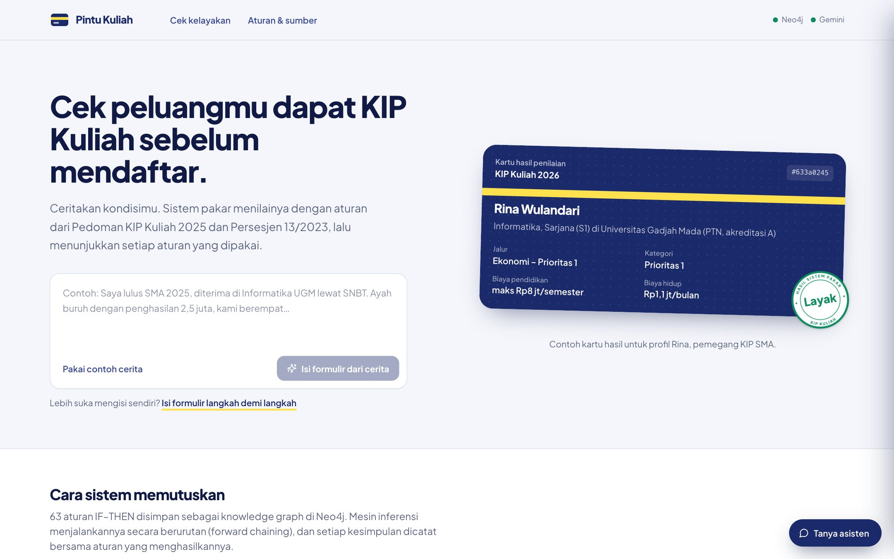

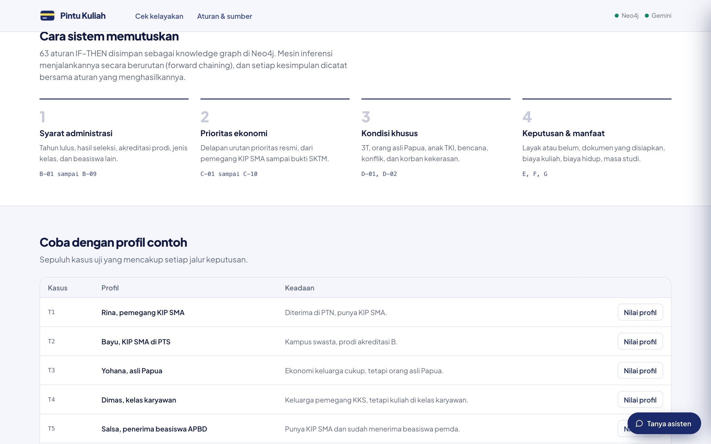


### 2.2 Cek kelayakan

Halaman ini berisi kotak **Mulai dari cerita** dan formulir empat langkah. Isian yang diisi Gemini diberi tanda stabilo kuning **dari cerita**, jadi periksa kembali isian itu. Jika ada data yang belum disebut di cerita, sistem menampilkan daftar "Belum disebut di ceritamu".

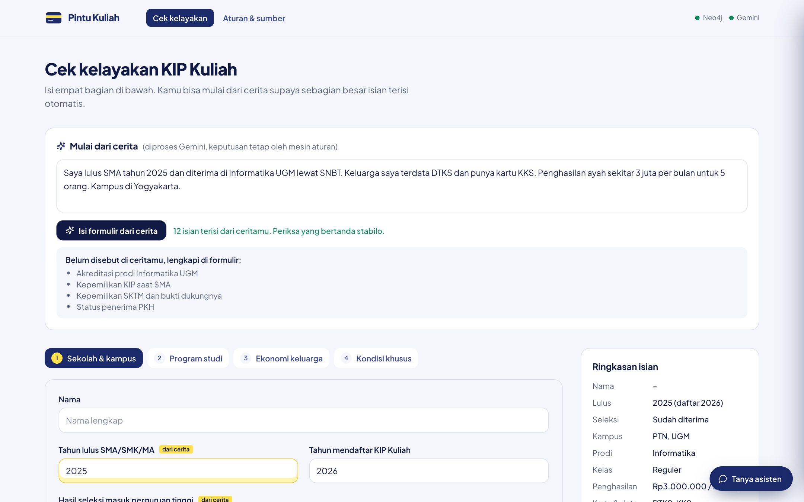


| Langkah | Isian | Dipakai oleh aturan |
|---|---|---|
| 1. Sekolah & kampus | Nama, tahun lulus SMA, tahun mendaftar, hasil seleksi PT, jenis kampus (PTN/PTS), nama kampus, zona biaya hidup | A-01, B-01–B-04, C-01–C-06, G-05–G-09 |
| 2. Program studi | Nama prodi, rumpun prodi, akreditasi, jenjang, jenis kelas, beasiswa lain | A-02–A-05, B-05–B-07, G-01–G-04, G-10–G-21 |
| 3. Ekonomi keluarga | KIP SMA, DTKS, PKH, KKS, P3KE beserta desilnya, asal panti, penghasilan gabungan, jumlah anggota keluarga, SKTM dan bukti dukungnya | A-06–A-09, C-01–C-08 |
| 4. Kondisi khusus | 3T, orang asli Papua, anak TKI di perbatasan, bencana, konflik, korban kekerasan, korban pelanggaran HAM | D-01, D-02, F-09 |

Tips pengisian:

- **Zona biaya hidup** mengikuti kota kampus (A sampai E). Daftar kota per zona ada di laman resmi KIP Kuliah.
- **Rumpun prodi** menentukan batas biaya kedokteran (G-02) dan kelanjutan ke program profesi (G-15–G-21).
- **Desil P3KE** hanya muncul jika "terdata P3KE" dicentang.
- Di bawah isian penghasilan, sistem langsung menampilkan **penghasilan per kapita**, yaitu nilai yang diuji aturan A-08.

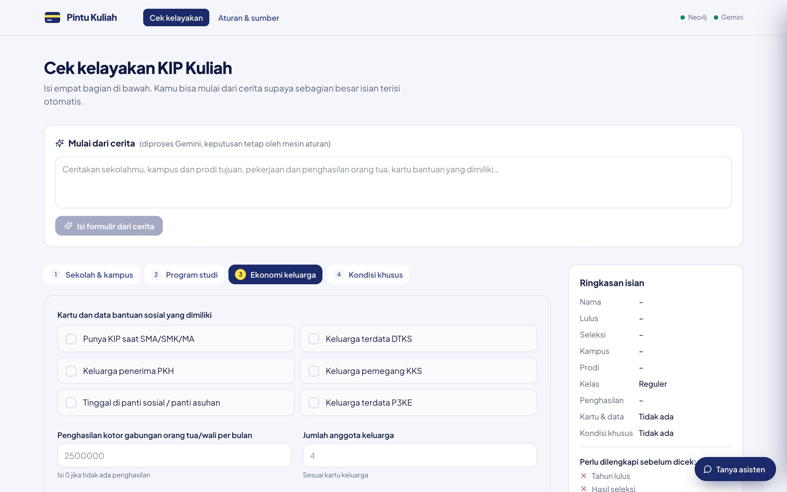


Panel **Ringkasan isian** di samping formulir merangkum semua isian. Tombol **Cek kelayakan** aktif setelah semua isian wajib terisi.

### 2.3 Hasil

Halaman hasil dijelaskan rinci di [bagian 3](#3-membaca-hasil-penilaian). Fitur interaktifnya:

- **Tanya asisten soal hasil ini** (tombol kuning di kartu) membuka drawer asisten yang sudah membaca kasus tersebut.
- **Checklist dokumen**: centang dokumen yang sudah siap. Penghitung *x/y* ikut berubah.
- **Jelaskan hasil ini**: Gemini merangkum jejak aturan menjadi penjelasan singkat dalam bahasa sehari-hari.
- **Jejak aturan / Graf penalaran**: dua tab untuk melihat alasan keputusan, sebagai daftar atau sebagai graf.

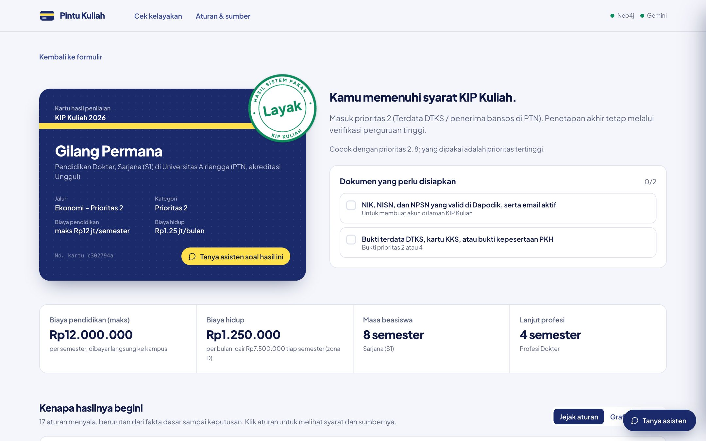


### 2.4 Asisten (drawer)

- Klik **Tanya asisten** di pojok kanan bawah halaman mana pun. Drawer akan terbuka dari kanan tanpa berpindah halaman.
- Tutup drawer dengan tombol ✕, tombol Esc, atau klik area gelap di luar drawer.
- Di halaman hasil, judul drawer berubah menjadi "Tanya soal hasil ini". Asisten ikut membaca keputusan, prioritas, dan jejak aturan kasus itu, dan contoh pertanyaannya ikut menyesuaikan.
- Jawaban asisten menyertakan nomor aturan, misalnya `[C-02]`. Klik chip itu untuk membuka aturannya di halaman Aturan & sumber.
- Riwayat percakapan tetap tersimpan selama kasusnya sama, dan dimulai baru ketika kasusnya berganti.

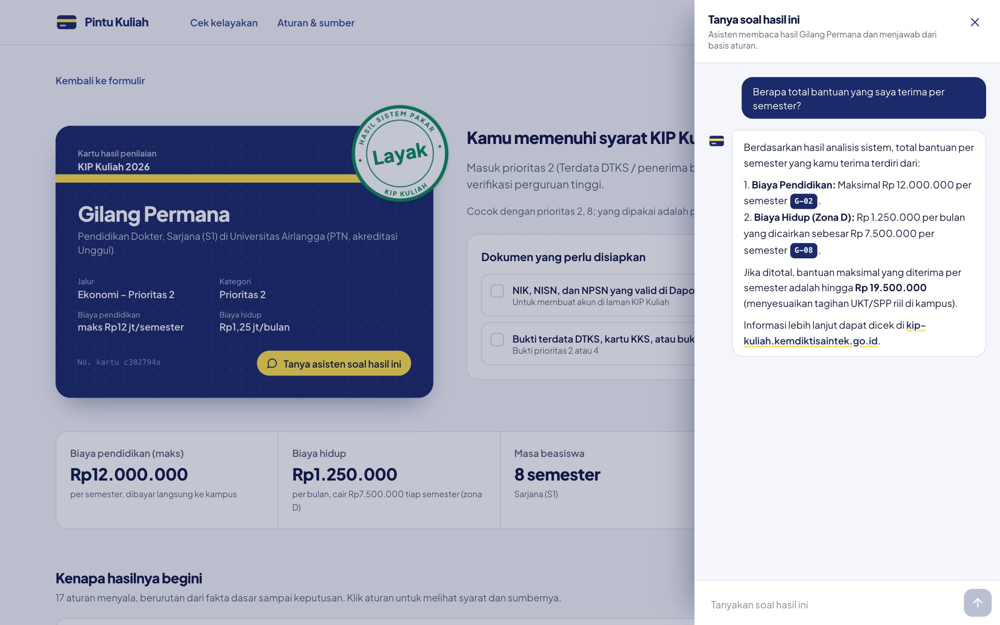


### 2.5 Aturan & sumber

- Berisi daftar 63 aturan IF–THEN, dikelompokkan per lapis A–G.
- Bisa disaring per lapis atau dicari dengan kata kunci, misalnya "SKTM".
- Setiap aturan menampilkan bagian **Jika**, **Maka**, strata, dan sumber regulasinya (kode PED/PS/PM beserta halaman atau pasalnya).
- Bagian **graf ontologi** menampilkan kelas (abu-abu) dengan hierarki `SUBKELAS_DARI`, aturan (biru tua) yang terhubung ke konsep yang disimpulkannya, serta regulasi sumbernya.

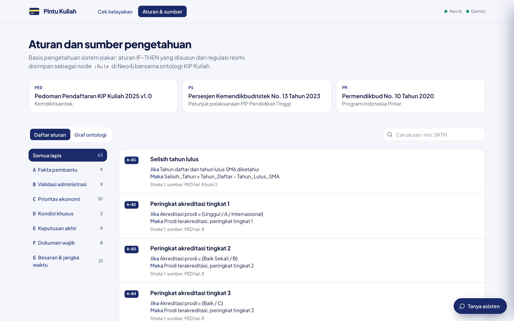


### 2.6 Melihat langsung di Neo4j

Semua data aplikasi tersimpan di Neo4j dan bisa dibuka langsung lewat Neo4j Browser atau Neo4j Bloom. Langkah lengkapnya ada di [bagian 4](#4-membaca-data-di-neo4j).

---

## 3. Membaca hasil penilaian

Contoh di bagian ini memakai profil **T10, Gilang Permana**: calon dokter di Universitas Airlangga (PTN), prodi akreditasi Unggul, keluarga terdata DTKS, penghasilan Rp3,2 juta untuk 4 orang, zona D.

### 3.1 Kartu hasil dan stempel

| Bagian kartu | Arti | Asal datanya |
|---|---|---|
| Stempel **Layak** (hijau) / **Belum layak** (merah) | Keputusan akhir | Lapis E (E-01–E-04) |
| Nama, prodi, kampus, akreditasi | Ringkasan isian | Fakta masukan |
| **Jalur** | `Ekonomi – Prioritas k`, `Pertimbangan khusus`, `Gugur administrasi`, atau `Tidak memenuhi kriteria ekonomi` | Properti `jalur` yang diisi aturan E |
| **Kategori** | Nomor prioritas yang dipakai, atau "Pertimbangan khusus" | C-09 (prioritas terkecil) |
| **Biaya pendidikan** | Batas UKT per semester | G-01–G-04 |
| **Biaya hidup** | Bantuan per bulan sesuai zona | G-05–G-09 |
| No. kartu | ID node `:Pendaftar` di Neo4j | Dibuat saat evaluasi |

Gilang: **Layak**, jalur **Ekonomi – Prioritas 2**, biaya pendidikan maks Rp12 juta/semester, biaya hidup Rp1,25 juta/bulan.

### 3.2 Kolom putusan

- **Layak:** kalimat "Masuk prioritas *k* (*nama kategori*)". Jika pendaftar cocok dengan lebih dari satu prioritas, muncul catatan "Cocok dengan prioritas 2, 8; yang dipakai adalah prioritas tertinggi". Gilang cocok dengan prioritas 2 (DTKS di PTN, aturan C-02) dan prioritas 8 (penghasilan, aturan C-08). Aturan C-09 memilih prioritas dengan nomor terkecil, yaitu 2.
- **Belum layak karena gugur administrasi:** muncul kotak merah "Gugur di syarat administrasi" berisi **semua** alasan gugur beserta nomor aturannya (B-02 sampai B-07).
- **Belum layak karena ekonomi:** muncul kalimat "Syarat administrasi terpenuhi, tetapi tidak ada kriteria ekonomi maupun kondisi khusus yang cocok" (aturan E-04).
- **Dokumen yang perlu disiapkan:** dihasilkan lapis F, sesuai jalur yang dipakai. Gilang mendapat F-00 (data akun) dan F-02 (bukti DTKS/KKS/PKH).
- **Kondisi khusus tercatat:** muncul bila D-01 menyala.

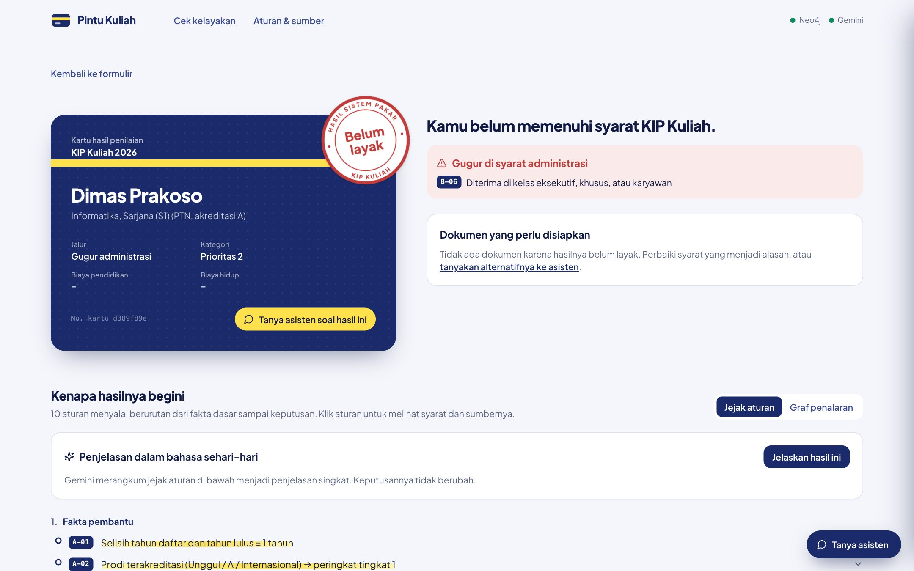


### 3.3 Baris manfaat

Empat kotak manfaat hanya muncul bila hasilnya layak:

| Kotak | Aturan | Gilang |
|---|---|---|
| Biaya pendidikan (maks) | G-01–G-04 | Rp12.000.000/semester (G-02: akreditasi tingkat 1 + Kedokteran) |
| Biaya hidup | G-05–G-09 | Rp1.250.000/bulan, cair Rp7.500.000 per semester (G-08: zona D) |
| Masa beasiswa | G-10–G-14 | 8 semester (G-10: Sarjana) |
| Lanjut profesi | G-15–G-21 | Profesi Dokter, 4 semester (G-15) |

### 3.4 Jejak aturan

Tab **Jejak aturan** menampilkan setiap aturan yang menyala, dikelompokkan per lapis dan diurutkan sesuai urutan menyalanya. Setiap baris memuat:

- chip nomor aturan (mis. `C-02`);
- **kesimpulan** yang diberi stabilo, berisi nilai konkret kasus itu (mis. "per kapita Rp800.000");
- isi aturan saat baris diklik: bagian **Jika**, bagian **Maka**, dan sumber regulasinya.

Jejak lengkap Gilang (17 aturan):

| Urutan | Aturan | Strata | Kesimpulan |
|---|---|---|---|
| 1 | A-01 | 1 | Selisih tahun daftar dan tahun lulus = 1 tahun |
| 2 | A-02 | 1 | Prodi terakreditasi (Unggul) → peringkat tingkat 1 |
| 3 | A-06 | 1 | Keluarga tercatat sebagai penerima bansos (DTKS) |
| 4 | A-08 | 1 | Penghasilan Rp3.200.000/bulan, per kapita Rp800.000 → memenuhi batas miskin/rentan miskin |
| 5 | B-01 | 2 | Lulus 1 tahun sebelum pendaftaran (maks 2 tahun) → memenuhi |
| 6 | C-02 | 2 | Cocok dengan prioritas 2: DTKS/bansos di PTN |
| 7 | C-08 | 2 | Cocok dengan prioritas 8: miskin dengan bukti penghasilan |
| 8 | B-08 | 3 | Semua syarat administrasi terpenuhi |
| 9 | C-09 | 3 | Kategori ekonomi: Prioritas 2 |
| 10 | D-02 | 3 | Tidak memiliki kondisi khusus |
| 11 | E-02 | 4 | Layak melalui jalur ekonomi Prioritas 2 |
| 12 | F-00 | 5 | Wajib menyiapkan NIK, NISN, NPSN, dan email aktif |
| 13 | F-02 | 5 | Wajib menyiapkan bukti DTKS/KKS/PKH |
| 14 | G-02 | 5 | Biaya pendidikan maks Rp12.000.000 per semester |
| 15 | G-08 | 5 | Biaya hidup zona D: Rp1.250.000/bulan |
| 16 | G-10 | 5 | Masa beasiswa maksimal 8 semester |
| 17 | G-15 | 5 | Dapat dilanjutkan ke Profesi Dokter maks 4 semester |

Cara membaca jejak ini sebagai rantai penalaran:

1. **Fakta masukan** (DTKS, PTN, penghasilan, akreditasi) memicu **fakta pembantu** di lapis A. Contohnya A-06 menyimpulkan `penerima_bansos = true`.
2. Fakta pembantu itu menjadi syarat lapis berikutnya. C-02 hanya bisa menyala setelah A-06 menyala. Inilah inti *forward chaining*: kesimpulan satu aturan menjadi premis aturan lain.
3. Aturan strata 3 (B-08, C-09, D-02) baru dijalankan setelah strata 2 selesai, karena aturan-aturan ini memakai negasi ("tidak ada alasan gugur") atau agregat (prioritas minimum). Lihat [6.4](#64-aturan-sebagai-insert--where-dan-forward-chaining).
4. Lapis E mengambil keputusan, lalu lapis F dan G menurunkan konsekuensinya.

Tombol **Jelaskan hasil ini** di atas jejak meminta Gemini menceritakan ulang rantai ini dalam bahasa sehari-hari. Keputusan tidak berubah karena Gemini hanya membaca jejak yang sudah ada.

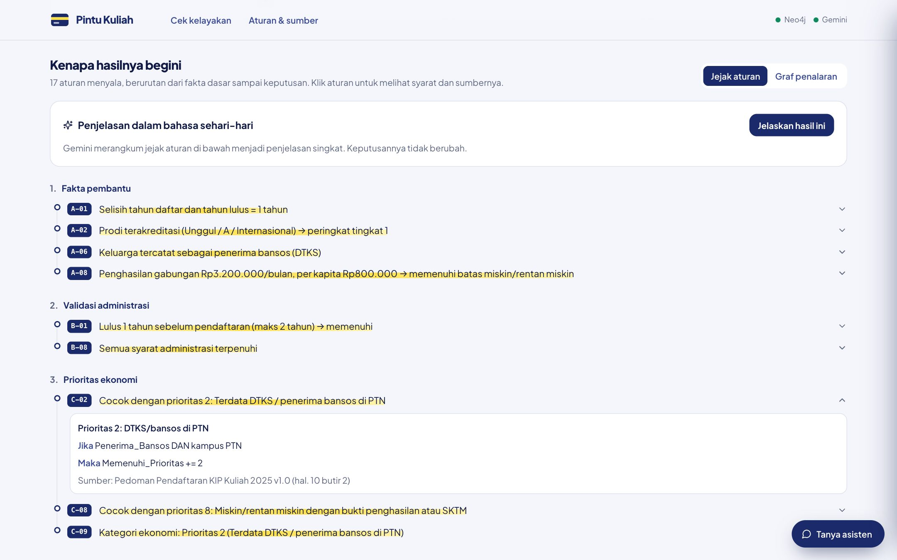


### 3.5 Graf penalaran

Tab **Graf penalaran** menampilkan subgraf Neo4j untuk kasus tersebut:

| Warna/node | Arti |
|---|---|
| Kuning (besar) | Node `:Pendaftar` |
| Biru tua | Node `:Rule` yang menyala (relasi `MEMICU`) |
| Ungu | Node `:Sumber` (regulasi), terhubung lewat `BERDASARKAN` |
| Warna lain | Konsep yang disimpulkan: kategori ekonomi, dokumen, manfaat, keputusan, alasan gugur, kondisi khusus, kelas kampus |

Graf ini adalah *fasilitas penjelasan* dalam bentuk visual. Dari satu pendaftar, kita bisa menelusuri aturan yang menyala sampai ke pasal regulasi yang mendasarinya.

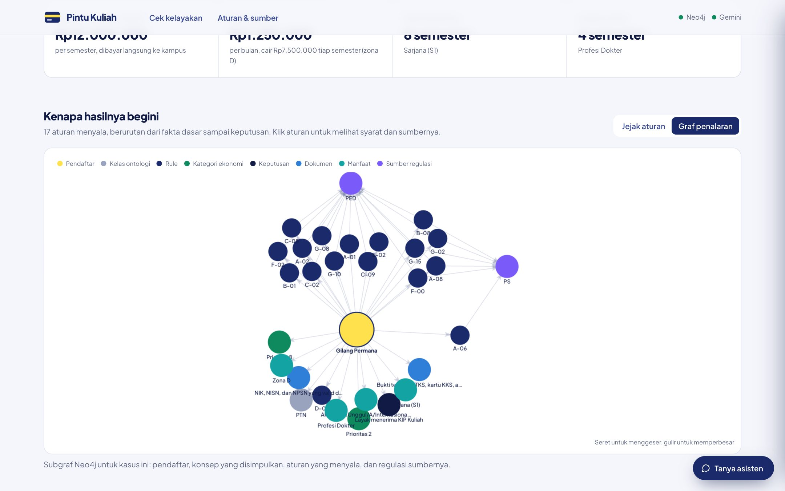


### 3.6 Pola hasil yang perlu dikenali

| Pola | Contoh | Penjelasan |
|---|---|---|
| Cocok banyak prioritas | T8: prioritas 5 dan 7 (juga 8) | C-09 memilih nomor terkecil. Semua kecocokan tetap tercatat di `COCOK_PRIORITAS` |
| Gugur tetapi punya prioritas | T4: C-02 dan C-09 menyala, tetapi B-06 menggugurkan | Lapis C tetap berjalan agar jejaknya lengkap. Keputusan diambil E-01 karena administrasi gagal |
| Layak tanpa prioritas | T3: C-10 + D-01 → E-03 | Jalur pertimbangan khusus (afirmasi) |
| Tidak ada manfaat | Semua kasus tidak layak | Lapis F dan G mensyaratkan `keputusan = 'Layak'` |

---

## 4. Membaca data di Neo4j

Semua yang tampil di aplikasi berasal dari Neo4j: ontologi, 63 aturan, setiap pendaftar yang pernah dinilai, dan jejak penalarannya. Bagian ini menjelaskan cara membuka database dan membaca isinya, sehingga hasil di layar bisa dibuktikan langsung di knowledge graph.

### 4.1 Membuka Neo4j Browser

1. Pastikan instance **SPL-KIP** berstatus *Running* di Neo4j Desktop.
2. Buka Neo4j Browser, lewat tombol **Open → Neo4j Browser** di Desktop atau langsung di http://localhost:7474.
3. Isi formulir koneksi:
   - **Connect URL:** `neo4j://127.0.0.1:7687`
   - **Username:** `neo4j`
   - **Password:** password instance (sama dengan `NEO4J_PASSWORD` di `backend/.env`)
4. Klik **Connect**. Jika berhasil, muncul tulisan "Connected to neo4j://127.0.0.1:7687" dan titik hijau di samping nama instance di kiri atas.

> Neo4j Desktop versi terbaru memakai tampilan Browser/Query yang baru (gambar di panduan ini). Versi lama tampilannya sedikit berbeda, tetapi query dan cara membacanya sama.

### 4.2 Mengenal tampilan Neo4j Browser

| Bagian | Fungsi |
|---|---|
| **Editor** (baris paling atas) | Tempat mengetik query Cypher. Jalankan dengan **Ctrl/Cmd + Enter** atau tombol **Run** |
| **Frame hasil** | Setiap query menghasilkan satu frame baru di bawah editor. Ketik `:clear` untuk menghapus semua frame |
| Tab **Graph** | Node sebagai lingkaran (warnanya mengikuti label) dan relasi sebagai panah berlabel |
| Tab **Table** / **RAW** | Hasil dalam bentuk tabel atau JSON. Cocok untuk query yang mengembalikan kolom, bukan node |
| **Results overview** (kanan frame) | Daftar label dan tipe relasi pada hasil query beserta jumlahnya. Klik satu node atau relasi di graf untuk melihat semua propertinya, misalnya `penghasilan`, `prioritas`, atau `kesimpulan` |
| Klik ganda pada node | Menampilkan tetangga node itu (*expand*) |
| **Database information** (panel kiri) | Daftar semua label (Nodes), tipe relasi (Relationships), dan property keys di database. Klik nama label untuk menampilkan contoh node berlabel itu |

Tips membaca graf:

- Angka di samping nama label pada Results overview (mis. `Rule (16)`) menunjukkan jumlah node per label pada hasil query.
- **Atur teks pada node.** Secara bawaan Neo4j memilih properti sembarang sebagai teks node; misalnya node pendaftar bisa bertuliskan "Unggul" (nilai akreditasi). Klik chip label di Results overview, lalu di panel **Customize Style** pilih properti di bagian **Caption**. Gambar di panduan ini memakai: `Pendaftar`/`PendaftarLayak` → `nama`, `Kelas` → `nama`, `Rule` → `id`, `Sumber` → `kode`, `KategoriEkonomi`/`Dokumen`/`Jenjang`/`BiayaPendidikan`/`ProgramProfesi`/`Keputusan` → `kode`, `ZonaBiayaHidup` → `zona`. Pengaturan ini tersimpan di browser.
- Di panel yang sama bisa diatur warna dan ukuran node.
- Seret node untuk merapikan tata letak, dan pakai tombol zoom di pojok kanan bawah graf. Tata letak tidak memengaruhi data.

### 4.3 Peta isi database

| Label | Jumlah | Isi |
|---|---|---|
| `Kelas` | 19 | Kelas ontologi (TBox), terhubung lewat `SUBKELAS_DARI` |
| `Rule` | 63 | Aturan IF–THEN beserta properti `jika`, `maka`, `lapis`, `strata` |
| `Sumber` | 3 | Regulasi PED, PS, PM |
| `KategoriEkonomi` | 8 | Prioritas 1–8 |
| `KondisiKhusus` | 7 | 3T, Papua, TKI, bencana, konflik, kekerasan, HAM |
| `AlasanGugur` | 6 | B-02–B-07 |
| `Keputusan` | 2 | LAYAK, TIDAK_LAYAK |
| `Dokumen` | 8 | Dokumen wajib |
| `BiayaPendidikan`, `ZonaBiayaHidup`, `Jenjang`, `ProgramProfesi` | 4, 5, 5, 7 | Instance subkelas `Manfaat` |
| `Pendaftar` | bertambah | Satu node setiap kali formulir dinilai, ditambah label `PendaftarLayak` atau `PendaftarTidakLayak` |

Yang perlu diingat:

- **Setiap penilaian membuat node `Pendaftar` baru.** Menilai profil Gilang dua kali menghasilkan dua node bernama sama. Karena itu query di bawah memakai `ORDER BY p.dibuat DESC LIMIT 1` untuk mengambil penilaian terbaru.
- **Properti masukan dan turunan disimpan di node yang sama.** Properti seperti `penghasilan`, `dtks`, `jenis_kampus` berasal dari formulir. Properti seperti `penerima_bansos`, `prioritas`, `keputusan`, `jalur` ditulis oleh aturan.
- **Jangan mengubah node `Rule` atau ontologi secara manual.** Saat backend start atau `POST /api/seed` dipanggil, semua node selain `Pendaftar` dibuat ulang dari kode.

### 4.4 Langkah membaca, dari skema sampai jejak

Jalankan query berikut berurutan di Neo4j Browser.

#### Langkah 1: lihat skema graf

```cypher
CALL db.schema.visualization()
```

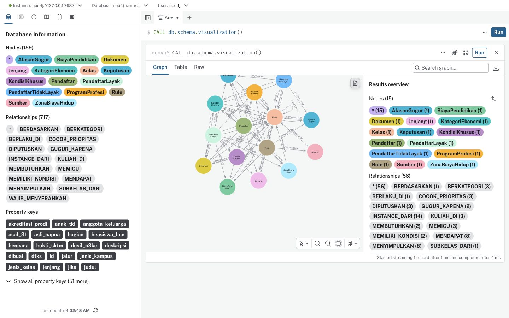

Skema menampilkan **satu node per label** dan **satu panah per tipe relasi**. Jika node skema tidak bertuliskan nama label, atur Caption setiap label ke `<type>`. Ini adalah gambaran domain dan range setiap relasi (lihat [6.2](#62-representasi-pengetahuan-dari-rdfrdfs-ke-property-graph)). Misalnya panah `COCOK_PRIORITAS` selalu berjalan dari `Pendaftar` ke `KategoriEkonomi`.

#### Langkah 2: lihat hierarki kelas (TBox)

```cypher
MATCH path = (:Kelas)-[:SUBKELAS_DARI*]->(:Kelas {nama: 'Entitas'})
RETURN path
```

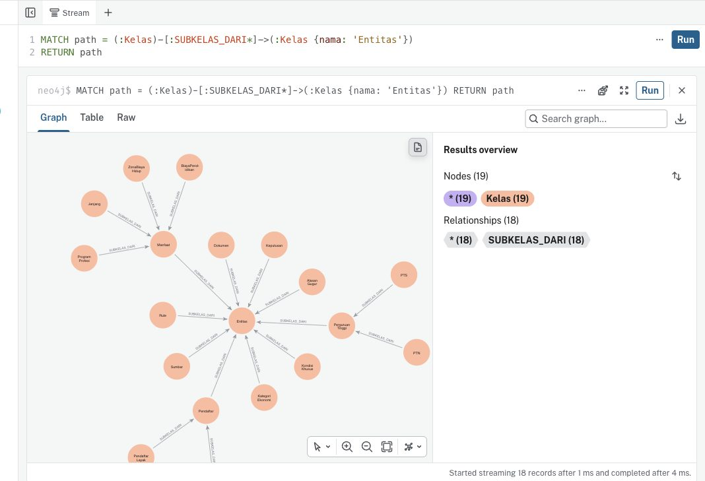

Cara membaca: panah `SUBKELAS_DARI` sama dengan `rdfs:subClassOf`. Rantai `PendaftarLayak → Pendaftar → Entitas` adalah contoh **rdfs11** (transitif). `BiayaPendidikan`, `ZonaBiayaHidup`, `Jenjang`, dan `ProgramProfesi` mengarah ke `Manfaat`, yang menjadi dasar **rdfs9** pada kotak manfaat.

#### Langkah 3: lihat satu pendaftar dan semua kesimpulannya

```cypher
MATCH (p:Pendaftar {nama: 'Gilang Permana'}) WITH p ORDER BY p.dibuat DESC LIMIT 1
MATCH (p)-[r]->(n) WHERE NOT n:Rule
RETURN p, r, n
```

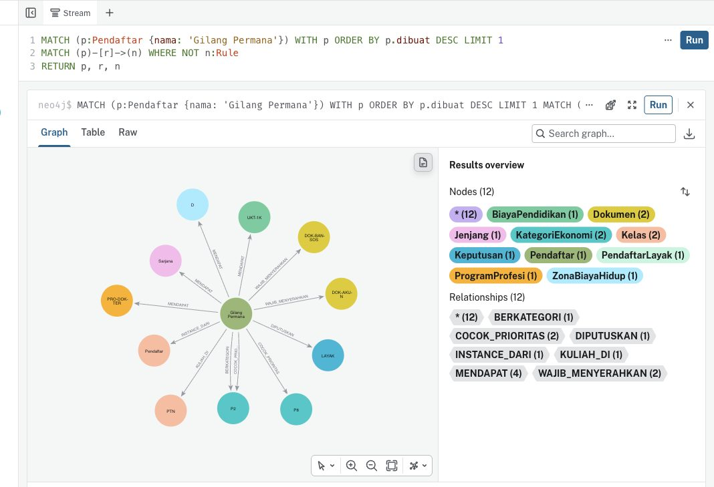

Cara membaca:

- Node di tengah adalah Gilang. Klik node itu untuk melihat properti masukan (mis. `penghasilan: 3200000`, `dtks: true`) dan properti turunan (`penerima_bansos: true`, `prioritas: 2`, `keputusan: "Layak"`).
- `COCOK_PRIORITAS` ke Prioritas 2 **dan** Prioritas 8, tetapi `BERKATEGORI` hanya ke Prioritas 2. Ini hasil agregat `MIN` di aturan C-09 (juga contoh **rdfs7**: `BERKATEGORI ⊑ COCOK_PRIORITAS`).
- `DIPUTUSKAN` ke `Layak`, `WAJIB_MENYERAHKAN` ke dua dokumen, dan `MENDAPAT` ke empat manfaat. Isinya sama persis dengan halaman hasil.
- `KULIAH_DI` mengarah ke kelas `PTN`, dan `INSTANCE_DARI` ke kelas `Pendaftar`.

#### Langkah 4: lihat jejak penalaran sebagai graf

```cypher
MATCH (p:Pendaftar {nama: 'Gilang Permana'}) WITH p ORDER BY p.dibuat DESC LIMIT 1
MATCH (p)-[m:MEMICU]->(r:Rule)-[b:BERDASARKAN]->(s:Sumber)
RETURN p, m, r, b, s
```

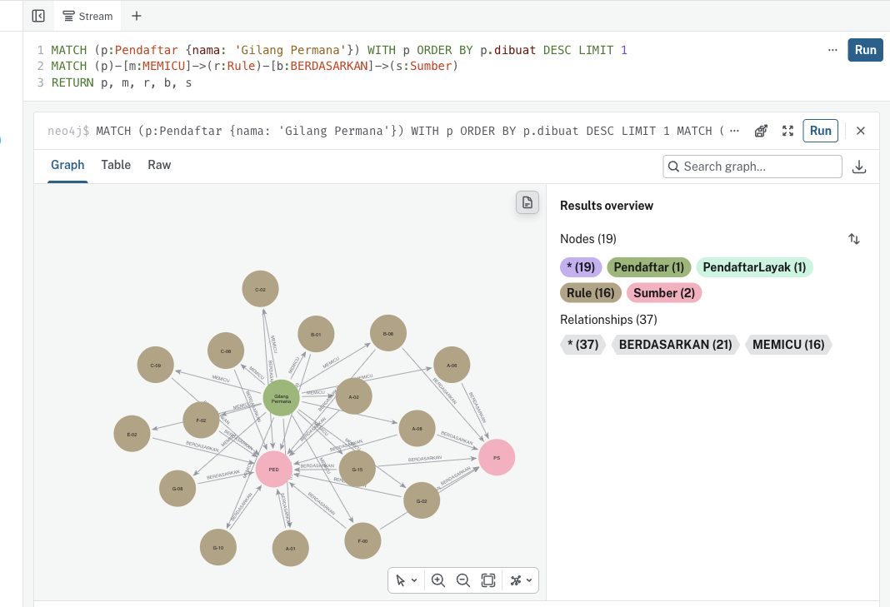

Setiap panah `MEMICU` adalah satu aturan yang menyala untuk Gilang. Ini padanan provenance `:derivedBy` di materi. Aturan tanpa sumber regulasi (pada kasus Gilang: D-02) tidak muncul di query ini karena tidak punya relasi `BERDASARKAN`. Klik panah `MEMICU` untuk melihat properti `urutan` dan `kesimpulan`.

#### Langkah 5: lihat jejak penalaran sebagai tabel

```cypher
MATCH (p:Pendaftar {nama: 'Gilang Permana'}) WITH p ORDER BY p.dibuat DESC LIMIT 1
MATCH (p)-[m:MEMICU]->(r:Rule)
RETURN m.urutan AS urutan, r.id AS aturan, r.nama AS nama, m.kesimpulan AS kesimpulan
ORDER BY urutan
```

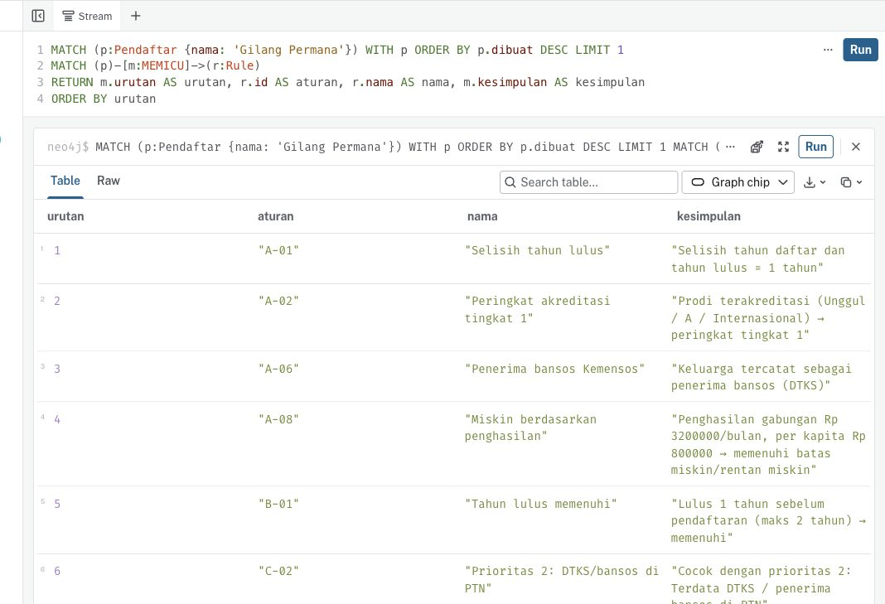

Tabel ini adalah sumber data tab **Jejak aturan** di halaman hasil. Kolom `urutan` menunjukkan urutan forward chaining: lapis A dulu, lalu strata 2 (B-01, C-02, C-08), strata 3 (B-08, C-09, D-02), keputusan E-02, kemudian F dan G.

#### Langkah 6: lihat satu aturan beserta konsep dan sumbernya

```cypher
MATCH (r:Rule {id: 'C-02'})-[x]-(n) WHERE NOT n:Pendaftar
RETURN r, x, n
```

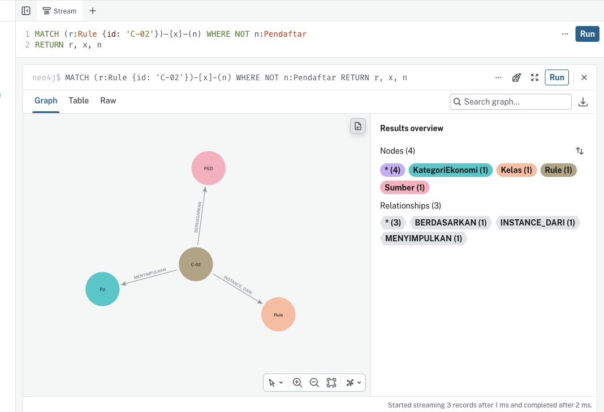

Klik node `C-02` untuk melihat properti `jika`, `maka`, `lapis`, dan `strata`. Relasi `MENYIMPULKAN` menunjukkan konsep yang bisa dihasilkan aturan ini, sedangkan `BERDASARKAN` menunjukkan pasal regulasinya (properti `bagian` di relasi itu berisi halaman atau pasalnya).

### 4.5 Memakai Neo4j Bloom

Bloom cocok untuk eksplorasi visual tanpa menulis Cypher, tetapi hanya menampilkan node yang dicari.

1. Buka **Open → Neo4j Bloom** dari Neo4j Desktop.
2. Di kotak pencarian, ketik nama label (mis. `Pendaftar`), lalu tekan Enter.
3. Klik kanan node, lalu pilih **Expand → All** untuk menampilkan tetangganya.
4. Untuk pola yang lebih spesifik, ketik misalnya `Pendaftar COCOK_PRIORITAS KategoriEkonomi`.

Jika Bloom terlihat "kosong" atau hanya menampilkan sedikit node, itu karena Bloom belum diminta mencari. Datanya tetap lengkap di database.

---

## 5. Basis aturan dan aturan tambahan

Daftar lengkap ada di halaman **Aturan & sumber** dan [Expert Project/Rules-Revisi.md](../Expert%20Project/Rules-Revisi.md). Kode di [backend/app/rules.py](../backend/app/rules.py).

### 5.1 Tujuh lapis aturan

| Lapis | Nama | Aturan | Jumlah | Strata | Menghasilkan |
|---|---|---|---|---|---|
| A | Fakta pembantu | A-01–A-09 | 9 | 1 | `selisih_tahun`, `tingkat_akreditasi`, `penerima_bansos`, `rentan_p3ke`, `miskin_penghasilan`, `miskin_sktm` |
| B | Validasi administrasi | B-01–B-07 / B-08, B-09 | 9 | 2 / 3 | `GUGUR_KARENA → AlasanGugur`, `status_administrasi` |
| C | Prioritas ekonomi | C-01–C-08 / C-09, C-10 | 10 | 2 / 3 | `COCOK_PRIORITAS`, `BERKATEGORI → KategoriEkonomi` |
| D | Kondisi khusus | D-01 / D-02 | 2 | 2 / 3 | `MEMILIKI_KONDISI → KondisiKhusus` |
| E | Keputusan akhir | E-01–E-04 | 4 | 4 | `keputusan`, `jalur`, label `:PendaftarLayak` / `:PendaftarTidakLayak`, `DIPUTUSKAN` |
| F | Dokumen wajib | F-00–F-06, F-09 | 8 | 5 | `WAJIB_MENYERAHKAN → Dokumen` |
| G | Besaran & jangka waktu | G-01–G-21 | 21 | 5 | `MENDAPAT → BiayaPendidikan / ZonaBiayaHidup / Jenjang / ProgramProfesi` |
| | | | **63** | | |

Sumber pengetahuan:

- **PED**: Pedoman Pendaftaran KIP Kuliah 2025 v1.0.
- **PS**: Persesjen Kemendikbudristek No. 13 Tahun 2023 (Juklak PIP Pendidikan Tinggi).
- **PM**: Permendikbud No. 10 Tahun 2020.

### 5.2 Aturan tambahan dibanding rancangan awal

Rancangan awal (BAB III versi lama, R-01 sampai R-20) direvisi. Tabel berikut merangkum aturan dan variabel yang **ditambahkan**, beserta alasannya.

| Aturan/variabel baru | Isi | Alasan penambahan |
|---|---|---|
| **A-09**, **C-08** (bagian SKTM), **F-06** | Bukti miskin lewat SKTM desa/kelurahan + rekening listrik + foto rumah | Pedoman hal. 12 butir 8b menyebut SKTM sebagai bukti alternatif. Versi lama hanya memodelkan penghasilan |
| Variabel `Memiliki_SKTM`, `Bukti_Dukung_SKTM` | Masukan untuk A-09 | Mendukung aturan di atas |
| **B-03** | Gugur jika tahun lulus setelah tahun daftar | Versi lama tidak menangani kasus ini, sehingga keputusannya kosong |
| **B-06** | Gugur jika kelas eksekutif/khusus/karyawan | Syarat di Persesjen Bab I huruf D angka 3i yang belum dijadikan aturan |
| **B-07** | Gugur jika sedang menerima beasiswa lain (APBN/APBD/sumber lain) | Persesjen Bab I huruf D angka 3h |
| **B-09** + pengumpulan semua alasan gugur | Seorang pendaftar bisa punya beberapa `GUGUR_KARENA` | Versi lama hanya menyimpan satu alasan |
| **C-09** (agregat `MIN`) | Kategori = prioritas dengan nomor terkecil dari semua yang cocok | Menggantikan rantai negasi panjang di R-08…R-12 yang rawan bug |
| **C-10** | Penanda "tidak memenuhi syarat ekonomi" | Dibutuhkan E-03 dan E-04 |
| Variabel `Terdata_P3KE` | Menggantikan konvensi `Desil_P3KE == 0` | Mencegah salah baca "tidak terdata" sebagai desil 0 |
| **A-02–A-05** (satu variabel akreditasi) | Unggul/A/Internasional → tingkat 1, Baik Sekali/B → tingkat 2, Baik/C → tingkat 3 | Menyatukan dua variabel akreditasi yang tumpang tindih |
| **D-02** (perbaikan) | "Tidak ada kondisi khusus" bila **semua** flag bernilai salah | Versi lama memakai OR sehingga menghasilkan kontradiksi |
| **E-03** | Layak lewat pertimbangan khusus bila lolos administrasi, tidak lolos ekonomi, tetapi punya kondisi khusus | Frasa "dan/atau pertimbangan khusus" (PS Bab I huruf C angka 1b). Versi lama menabrakkan R-19 dengan R-16/R-20 |
| **F-00** | Data akun (NIK, NISN, NPSN, email) untuk semua yang layak | Pedoman hal. 18 |
| **F-01–F-06, F-09** dipecah per jalur | Dokumen sesuai bukti yang dipakai | Versi lama menggabungkan semua dokumen |
| **G-10–G-14** | Masa beasiswa **selalu** ditampilkan bila layak | Versi lama hanya menyala bila masa studi melebihi batas |
| **G-15–G-21** | Kelanjutan ke program profesi (dokter, dokter gigi, dokter hewan, ners, apoteker, bidan, PPG) | Pedoman hal. 15 dan PS Bab I huruf D angka 3e. Belum dicakup versi lama |
| Syarat `Jumlah_Anggota_Keluarga ≥ 1` di A-08 | Mencegah pembagian dengan nol | Perbaikan teknis |

### 5.3 Asumsi interpretasi

- **Bukti miskin (prioritas 8):** penghasilan **atau** SKTM sudah cukup (OR). Verifikasi akhir tetap dilakukan perguruan tinggi.
- **Kondisi khusus adalah jalur tambahan, bukan syarat wajib.** Pendaftar yang lolos jalur ekonomi sekaligus punya kondisi khusus tetap masuk jalur ekonomi (E-02). Kondisi khususnya ikut dicatat dan menambah dokumen F-09.
- **Angka biaya pendidikan adalah batas atas.** Besaran riil diusulkan perguruan tinggi.
- **Ruang lingkup:** calon mahasiswa baru lulusan SMA/sederajat.

### 5.4 Aturan di luar mesin pakar (peran Gemini)

Gemini **tidak pernah mengambil keputusan**. Ada tiga batasan yang diterapkan di [backend/app/llm.py](../backend/app/llm.py):

1. **Ekstraksi:** Gemini hanya mengisi formulir dengan *structured output* sesuai skema. Pengguna tetap memeriksa isian bertanda stabilo, dan keputusan tetap diambil mesin aturan.
2. **Penjelasan:** Gemini hanya merangkai ulang jejak `MEMICU` yang sudah ada dan wajib menyebut nomor aturannya.
3. **Asisten:** Gemini hanya menjawab dari basis aturan di knowledge graph (beserta sumbernya) dan, di halaman hasil, dari hasil kasus itu. Jika pertanyaannya di luar basis pengetahuan, asisten menyatakannya dan mengarahkan ke laman resmi. Jika pengguna bertanya apakah dirinya layak, asisten mengarahkan ke fitur Cek kelayakan agar dinilai mesin aturan.

---

## 6. Kaitan dengan teori

### 6.1 Komponen sistem pakar

| Komponen (materi *Intro ES*) | Implementasi di Pintu Kuliah |
|---|---|
| Knowledge base: fakta dan aturan domain | Ontologi (kelas dan instance referensi) + 63 node `:Rule` di Neo4j ([ontology.py](../backend/app/ontology.py), [rules.py](../backend/app/rules.py)) |
| Working memory: fakta kasus | Node `:Pendaftar` beserta properti dan relasi yang terus bertambah selama inferensi |
| Inference engine | Forward chaining berstrata sampai fixpoint ([engine.py](../backend/app/engine.py), fungsi `infer`) |
| Explanation facility | Relasi `MEMICU {urutan, kesimpulan}` + `BERDASARKAN` ke sumber, ditampilkan sebagai Jejak aturan, Graf penalaran, dan penjelasan Gemini |
| User interface | Frontend React: formulir, kartu hasil, dan asisten |
| Knowledge acquisition | Aturan disusun dari Pedoman 2025, Persesjen 13/2023, dan Permendikbud 10/2020. Setiap aturan menyimpan rujukan halaman/pasalnya |

Forward chaining dipakai karena masalahnya *data-driven*: dari data pendaftar, sistem mencari semua kesimpulan yang bisa diturunkan (keputusan, dokumen, manfaat). Sistem tidak memulai dari satu hipotesis lalu membuktikannya.

### 6.2 Representasi pengetahuan: dari RDF/RDFS ke property graph

Materi kuliah memakai RDF/RDFS (triple). Proyek ini menyimpan ontologi yang sama di Neo4j (property graph). Padanannya:

| RDF / RDFS | Neo4j di proyek ini | Contoh |
|---|---|---|
| `rdfs:Class` | Node `:Kelas` | `(:Kelas {nama: 'KategoriEkonomi'})` |
| `C rdfs:subClassOf D` | `(C:Kelas)-[:SUBKELAS_DARI]->(D:Kelas)` | `PendaftarLayak → Pendaftar → Entitas` |
| `x rdf:type C` (`x a C`) | Relasi `(x)-[:INSTANCE_DARI]->(C:Kelas)` **dan** label Neo4j `x:C` | `(:KategoriEkonomi {kode:'P2'})-[:INSTANCE_DARI]->(:Kelas {nama:'KategoriEkonomi'})` |
| Properti objek `x P y` | Relasi `(x)-[:P]->(y)` | `(gilang)-[:COCOK_PRIORITAS]->(P2)` |
| Properti data (literal) | Properti node | `p.penghasilan = 3200000` |
| TBox (skema) | Node `:Kelas` + `SUBKELAS_DARI` | 19 kelas, 18 relasi subkelas; versi Turtle: `tbox.ttl` (6.6) |
| ABox (fakta) | Instance referensi + node `:Pendaftar` | Kategori, dokumen, zona, pendaftar; versi Turtle: `abox.ttl` (6.6) |
| Provenance `:derivedBy` | `(p)-[:MEMICU {urutan, kesimpulan}]->(r:Rule)` | Jejak penjelasan |

Hierarki kelas (TBox):

```
Entitas
├── Pendaftar
│   ├── PendaftarLayak
│   └── PendaftarTidakLayak
├── PerguruanTinggi
│   ├── PTN
│   └── PTS
├── Manfaat
│   ├── BiayaPendidikan
│   ├── ZonaBiayaHidup
│   ├── Jenjang
│   └── ProgramProfesi
├── KategoriEkonomi, KondisiKhusus, AlasanGugur, Keputusan, Dokumen
└── Rule, Sumber
```

Skema properti (domain dan range) yang dipakai aturan:

| Properti (relasi) | Domain | Range | Dibuat oleh |
|---|---|---|---|
| `COCOK_PRIORITAS` | Pendaftar | KategoriEkonomi | C-01–C-08 |
| `BERKATEGORI` | Pendaftar | KategoriEkonomi | C-09 |
| `GUGUR_KARENA` | Pendaftar | AlasanGugur | B-02–B-07 |
| `MEMILIKI_KONDISI` | Pendaftar | KondisiKhusus | D-01 |
| `DIPUTUSKAN` | Pendaftar | Keputusan | E-01–E-04 |
| `WAJIB_MENYERAHKAN` | Pendaftar | Dokumen | F-00–F-09 |
| `MENDAPAT` | Pendaftar | Manfaat | G-01–G-21 |
| `KULIAH_DI` | Pendaftar | PerguruanTinggi (menunjuk kelas PTN/PTS) | saat pendaftar dibuat |
| `MEMICU` | Pendaftar | Rule | setiap aturan yang menyala |
| `BERDASARKAN` | Rule | Sumber | seed ontologi |
| `MENYIMPULKAN` | Rule | konsep yang disimpulkan | seed ontologi |
| `BERLAKU_DI` | KategoriEkonomi | PerguruanTinggi | seed ontologi |
| `MEMBUTUHKAN` | KategoriEkonomi, KondisiKhusus | Dokumen | seed ontologi |

### 6.3 Pola entailment RDFS (rdfs2, rdfs3, rdfs7, rdfs9, rdfs11)

Materi *RDFS* (§9.2.1 RDF 1.1 Semantics) mendefinisikan aturan entailment berikut. Tabel ini menunjukkan di mana setiap aturan berlaku di Pintu Kuliah.

> **Catatan penting.** Pintu Kuliah tidak menjalankan reasoner RDFS terpisah seperti owlrl. Pola RDFS diwujudkan dengan tiga cara:
> 1. **dimaterialisasi**: fakta hasil entailment memang ditulis ke graf;
> 2. **saat query**: dihitung lewat jalur `SUBKELAS_DARI*`, padanan `rdf:type/rdfs:subClassOf*` di SPARQL;
> 3. **dijamin oleh konstruksi aturan**: setiap aksi aturan selalu menulis dari `p:Pendaftar` ke node berlabel kelas range. Jaminan ini bisa dicek dengan query, sesuai kegunaan RDFS untuk *checking* (materi *RDFS*, "Possible uses").
>
> Semua query di bawah sudah dijalankan di instance SPL-KIP dan hasilnya sesuai.

| Aturan RDFS | Bentuk | Di Pintu Kuliah | Cara |
|---|---|---|---|
| **rdfs2** (domain) | `P rdfs:domain C . x P y .` ⇒ `x a C` | Siapa pun yang punya `COCOK_PRIORITAS`, `GUGUR_KARENA`, `MENDAPAT`, `WAJIB_MENYERAHKAN`, atau `MEMICU` pasti seorang `Pendaftar` | Dijamin konstruksi; dicek dengan query |
| **rdfs3** (range) | `P rdfs:range C . x P y .` ⇒ `y a C` | Objek `COCOK_PRIORITAS` adalah `KategoriEkonomi`; objek `MENDAPAT` adalah `Manfaat`; objek `WAJIB_MENYERAHKAN` adalah `Dokumen` | Dijamin konstruksi; dicek dengan query |
| **rdfs7** (pewarisan properti) | `P rdfs:subPropertyOf Q . x P y .` ⇒ `x Q y` | `BERKATEGORI ⊑ COCOK_PRIORITAS`: kategori yang ditetapkan C-09 selalu salah satu prioritas yang cocok | Dijamin konstruksi (C-09 memilih dari `COCOK_PRIORITAS`); dicek dengan query |
| **rdfs9** (pewarisan kelas) | `C rdfs:subClassOf D . x a C .` ⇒ `x a D` | E-02 memberi label `:PendaftarLayak`, dan node itu tetap `:Pendaftar`. Instance `UKT-1K` bertipe `BiayaPendidikan`, sehingga juga `Manfaat` | Dimaterialisasi (label ganda) + saat query |
| **rdfs11** (transitif subkelas) | `C ⊑ D . D ⊑ E .` ⇒ `C ⊑ E` | `PendaftarLayak ⊑ Pendaftar ⊑ Entitas` ⇒ `PendaftarLayak ⊑ Entitas` | Saat query (`SUBKELAS_DARI*`) |
| rdfs5 (transitif subproperti) | | Tidak dipakai: hanya ada satu tingkat subproperti | |
| rdfs12, rdfs13, rdfs1/4/6/8/10 | container, datatype, *housekeeping* | Tidak dipakai | |

#### Contoh rantai entailment pada kasus Gilang

Materi *RDFS* (slide "Entailment in action") menunjukkan dua fakta yang menghasilkan tujuh fakta baru. Pola yang sama terjadi pada Gilang:

| Fakta | Asal |
|---|---|
| `gilang a Pendaftar` | **Fakta masukan** (node dibuat dengan label `:Pendaftar`) |
| `gilang MENDAPAT UKT-1K` | Aturan **G-02** (forward chaining) |
| `UKT-1K a BiayaPendidikan` | Fakta ontologi (ABox) |
| `gilang a PendaftarLayak` | Aturan **E-02** |
| `gilang a Pendaftar` | **rdfs9** dari `PendaftarLayak ⊑ Pendaftar`; juga **rdfs2** dari domain `MENDAPAT` |
| `PendaftarLayak ⊑ Entitas` | **rdfs11** |
| `gilang a Entitas` | **rdfs9** dengan hasil rdfs11 |
| `UKT-1K a Manfaat` | **rdfs9** dari `BiayaPendidikan ⊑ Manfaat`; konsisten dengan **rdfs3** (range `MENDAPAT` = Manfaat) |
| `gilang BERKATEGORI P2` | Aturan **C-09** |
| `gilang COCOK_PRIORITAS P2` | **rdfs7** dari `BERKATEGORI ⊑ COCOK_PRIORITAS` (sudah ada dari C-02) |
| `P2 a KategoriEkonomi` | **rdfs3** dari range `BERKATEGORI` |

Seperti di materi, aturan saling berantai. G-02 menghasilkan triple `MENDAPAT`, lalu rdfs2, rdfs3, dan rdfs9 menurunkan tipe-tipe baru dari triple itu.

#### Query untuk membuktikan pola RDFS di Neo4j

```cypher
// rdfs11: transitif subkelas (hasil: PendaftarLayak → Pendaftar → Entitas)
MATCH path = (:Kelas {nama: 'PendaftarLayak'})-[:SUBKELAS_DARI*]->(:Kelas)
RETURN [n IN nodes(path) | n.nama] AS jalur;

// rdfs9 (materialisasi): pendaftar layak tetap bertipe Pendaftar
MATCH (p:PendaftarLayak {nama: 'Gilang Permana'}) RETURN labels(p);
// → ['Pendaftar', 'PendaftarLayak']

// rdfs9 (saat query): semua manfaat Gilang lewat hierarki kelas
MATCH (p:Pendaftar {nama: 'Gilang Permana'})-[:MENDAPAT]->(x)
      -[:INSTANCE_DARI]->(:Kelas)-[:SUBKELAS_DARI*0..]->(:Kelas {nama: 'Manfaat'})
RETURN collect(DISTINCT coalesce(x.nama, 'Zona ' + x.zona));

// rdfs2 (cek domain): harus 0
MATCH (x)-[r:COCOK_PRIORITAS|GUGUR_KARENA|MENDAPAT|WAJIB_MENYERAHKAN|MEMICU|BERKATEGORI]->()
WHERE NOT x:Pendaftar RETURN count(r) AS pelanggaran;

// rdfs3 (cek range): harus 0
MATCH ()-[:MENDAPAT]->(y)
WHERE NOT (y)-[:INSTANCE_DARI]->(:Kelas)-[:SUBKELAS_DARI*0..]->(:Kelas {nama: 'Manfaat'})
RETURN count(y) AS pelanggaran;

// rdfs7 (cek subproperti BERKATEGORI ⊑ COCOK_PRIORITAS): harus 0
MATCH (p)-[:BERKATEGORI]->(k) WHERE NOT (p)-[:COCOK_PRIORITAS]->(k)
RETURN count(*) AS pelanggaran;
```

### 6.4 Aturan sebagai `INSERT … WHERE` dan forward chaining

Materi *SPARQL-Reasoning* menyebut `INSERT { head } WHERE { body }` sebagai bentuk aturan IF–THEN. Setiap aturan Pintu Kuliah adalah padanan langsungnya dalam Cypher:

| SPARQL Update | Cypher di Pintu Kuliah |
|---|---|
| `WHERE { body }` (bagian IF) | `MATCH (p:Pendaftar) WHERE <cond>` |
| `INSERT { head }` (bagian THEN) | `SET p.x = ...` atau `MERGE (p)-[:REL]->(konsep)` |
| Provenance `:derivedBy` | `MERGE (p)-[m:MEMICU]->(r:Rule) SET m.urutan, m.kesimpulan` |

Contoh aturan C-02 dalam kedua notasi:

```sparql
INSERT { ?p :cocokPrioritas :P2 }
WHERE  { ?p a :Pendaftar ; :penerimaBansos true ; :jenisKampus "PTN" }
```

```cypher
MATCH (p:Pendaftar {id: $pid}), (r:Rule {id: 'C-02'})
WHERE NOT (p)-[:MEMICU]->(r)
  AND p.penerima_bansos = true AND p.jenis_kampus = 'PTN'
WITH p, r MATCH (k:KategoriEkonomi {kode: 'P2'})
MERGE (p)-[:COCOK_PRIORITAS]->(k)
MERGE (p)-[m:MEMICU]->(r) SET m.urutan = $urutan, m.kesimpulan = '...'
```

Konsep reasoning dari materi dan penerapannya:

| Konsep (materi *SPARQL-Reasoning*) | Penerapan |
|---|---|
| **Forward chaining sampai fixpoint** (`fixpoint.py`) | `infer()` menjalankan semua aturan di satu strata berulang-ulang sampai tidak ada aturan baru yang menyala, lalu pindah ke strata berikutnya |
| **Negation as failure / closed world** (`FILTER NOT EXISTS`) | B-08 (`NOT (p)-[:GUGUR_KARENA]->()`), C-10 (`NOT (p)-[:COCOK_PRIORITAS]->()`), D-02 (semua flag salah). Data yang tidak ada dianggap salah |
| **Agregat sebagai aturan** (`GROUP BY … HAVING`) | C-09 memakai `ORDER BY k.prioritas LIMIT 1`, padanan `MIN`. B-09 dan D-01 memakai `count`/`collect` untuk teks penjelasan |
| **Default rule dengan pengecualian** | E-03: layak lewat kondisi khusus **kecuali** sudah lolos jalur ekonomi (`kategori_ekonomi = 'Tidak_Memenuhi'`) |
| **Aturan berantai** (R2 bergantung pada R1) | A-06 → C-02 → C-09 → E-02 → F-02 |

Jebakan aturan SPARQL (slide "Pitfalls") dan cara proyek ini mengatasinya:

| Jebakan | Penanganan |
|---|---|
| **Non-termination:** aturan yang membuat node baru setiap putaran | Aturan tidak pernah membuat node baru; `MERGE` hanya menautkan ke node referensi yang sudah ada. Setiap aturan paling banyak menyala sekali per pendaftar (`WHERE NOT (p)-[:MEMICU]->(r)`), jadi fixpoint pasti tercapai |
| **Order and negation:** aturan `NOT EXISTS` harus dijalankan setelah semua aturan yang bisa menambah fakta yang dinegasikan | **Stratifikasi** 5 tingkat. B-08, B-09, C-09, C-10, dan D-02 ada di strata 3, setelah semua B-0x, C-0x, dan D-01 (strata 2) selesai |
| **Stale conclusions:** mengubah fakta tidak menghapus turunannya | Setiap evaluasi membuat node pendaftar baru. Saat aturan atau ontologi dimuat ulang, `inferensi_ulang_semua()` menghapus semua fakta turunan lalu menghitung ulang dari fakta masukan (*full recomputation*) |
| **Tidak ada semantik standar untuk rule set** | Urutan dibuat deterministik: strata, lalu urutan aturan di `rules.py`. Kolom urutan di jejak mencatatnya |

Perbandingan empat cara reasoning di materi (OWL reasoner, SWRL, SPARQL rules, CLIPS) menempatkan Pintu Kuliah di kelompok **SPARQL rules / production rules**: dunia tertutup, mendukung negation as failure, agregat, dan aritmetika (selisih tahun, penghasilan per kapita), dengan jaminan terminasi dari desain aturannya sendiri.

### 6.5 Peta cepat: dari layar ke teori

| Yang terlihat di layar | Konsep teori |
|---|---|
| Isian formulir | Fakta ABox / working memory |
| Daftar di halaman Aturan & sumber | Knowledge base (aturan produksi IF–THEN) |
| Urutan di Jejak aturan | Forward chaining dan stratifikasi |
| Kesimpulan berstabilo di Jejak | Fakta turunan + provenance (`:derivedBy`) |
| "Yang dipakai adalah prioritas tertinggi" | Resolusi konflik dengan agregat `MIN` (C-09) |
| Stempel Layak / Belum layak | Klasifikasi ke subkelas `PendaftarLayak` / `PendaftarTidakLayak` (rdfs9 ke `Pendaftar`) |
| Kotak manfaat | Instance subkelas `Manfaat` (rdfs3 + rdfs9) |
| Graf penalaran | Explanation facility dalam bentuk knowledge graph |
| Graf ontologi | TBox (rdfs:subClassOf / rdfs11) |
| Jawaban asisten dengan chip `[C-02]` | LLM yang dibatasi pada knowledge base (grounded) |

### 6.6 TBox dan ABox dalam Turtle

Ontologi di Neo4j juga tersedia sebagai berkas RDF (Turtle) di folder `docs/ontologi/`. Dengan berkas ini pemetaan di 6.2 bisa diperiksa memakai alat RDF biasa, termasuk reasoner RDFS.

| Berkas | Isi |
|---|---|
| `tbox.ttl` | Skema: 19 kelas (`rdfs:Class` + `rdfs:subClassOf`), properti objek dengan `rdfs:domain`/`rdfs:range`, `BERKATEGORI rdfs:subPropertyOf COCOK_PRIORITAS` (rdfs7), dan properti data dengan range `xsd:*`. Properti data pendaftar dipisah menjadi fakta masukan dan fakta turunan (diberi catatan lapisnya) |
| `abox.ttl` | Fakta: 55 instance referensi, 63 aturan, dan pendaftar (satu node terbaru per nama) beserta semua fakta masukan, fakta turunan, dan relasinya. Dihasilkan dari Neo4j, jangan disunting manual |
| `ekspor_abox.py` | Membuat ulang `abox.ttl` dari isi Neo4j saat ini |
| `validasi.py` | Memeriksa ABox terhadap TBox lalu menjalankan closure RDFS |

TBox ditulis tangan dari `ontology.py` dan `rules.py`; aplikasi tidak membacanya. Jika kelas atau relasi di kode berubah, perbarui `tbox.ttl` juga. ABox cukup diekspor ulang setiap kali ada evaluasi baru:

```bash
uv run --directory backend --with rdflib python ../docs/ontologi/ekspor_abox.py
uv run --with rdflib --with owlrl python docs/ontologi/validasi.py "Gilang Permana"
```

Potongan TBox:

```turtle
@prefix kip: <http://pintukuliah.local/ontologi#> .

kip:PendaftarLayak a rdfs:Class ;
    rdfs:subClassOf kip:Pendaftar .

kip:BERKATEGORI a rdf:Property ;
    rdfs:subPropertyOf kip:COCOK_PRIORITAS ;   # rdfs7
    rdfs:domain kip:Pendaftar ;                # rdfs2
    rdfs:range kip:KategoriEkonomi .           # rdfs3
```

Potongan ABox untuk Gilang (diringkas):

```turtle
kip:pendaftar_Gilang_Permana a kip:Pendaftar, kip:PendaftarLayak ;
    kip:COCOK_PRIORITAS kip:KategoriEkonomi_P2, kip:KategoriEkonomi_P8 ;
    kip:BERKATEGORI kip:KategoriEkonomi_P2 ;
    kip:DIPUTUSKAN kip:Keputusan_LAYAK ;
    kip:MENDAPAT kip:BiayaPendidikan_UKT-1K, kip:ZonaBiayaHidup_D, kip:Jenjang_Sarjana ;
    kip:MEMICU kip:Rule_A-01, kip:Rule_C-02, kip:Rule_C-09 ;   # 17 aturan
    kip:dtks true ;
    kip:anggota_keluarga 4 .

[] a rdf:Statement ;                      # properti pada relasi MEMICU
    rdf:subject kip:pendaftar_Gilang_Permana ;
    rdf:predicate kip:MEMICU ;
    rdf:object kip:Rule_C-09 ;
    kip:urutan 9 ;
    kip:kesimpulan "Kategori ekonomi: Prioritas 2 (Terdata DTKS / penerima bansos di PTN)" .
```

Cara pemetaan dari Neo4j:

| Neo4j | Turtle |
|---|---|
| Label node dan relasi `INSTANCE_DARI` | `rdf:type` |
| Node `:Kelas` + `SUBKELAS_DARI` | `rdfs:Class` + `rdfs:subClassOf` (di `tbox.ttl`) |
| Properti node | Properti data; tipe xsd mengikuti nilainya (`true` → `xsd:boolean`, `4` → `xsd:integer`) |
| Relasi antarnode | Properti objek dengan nama tipe relasinya |
| Properti pada relasi (`MEMICU.urutan`, `MEMICU.kesimpulan`, `BERDASARKAN.bagian`) | Reifikasi `rdf:Statement`, karena RDF 1.1 tidak bisa menaruh properti pada triple |
| IRI individu | `kip:<Kelas>_<kode>` untuk data referensi (`kip:KategoriEkonomi_P2`, `kip:Rule_C-09`), `kip:pendaftar_<nama>` untuk pendaftar |

Tiga hal tidak bisa disalin apa adanya dari property graph ke RDFS:

- **`KULIAH_DI` dan `BERLAKU_DI`.** Di Neo4j kedua relasi ini menunjuk node kelas `PTN`/`PTS`, bukan kampus tertentu, karena kampus tidak dimodelkan sebagai individu. Range-nya di TBox karena itu `rdfs:Class`, bukan `PerguruanTinggi`. Dengan range `PerguruanTinggi`, validasi menemukan 2 pelanggaran rdfs3.
- **`MEMBUTUHKAN`.** Domainnya gabungan `KategoriEkonomi` dan `KondisiKhusus`. RDFS tidak punya *union*, dan dua `rdfs:domain` berarti irisan, jadi domainnya tidak ditulis.
- **Satu pendaftar, banyak node.** Setiap evaluasi di aplikasi membuat node `:Pendaftar` baru. Ekspor hanya mengambil node terbaru per nama, sehingga 22 node di Neo4j menjadi 12 individu di ABox.

Keluaran `validasi.py` saat panduan ini ditulis:

```
TBox 342 triple, ABox 3078 triple
1. Predikat tanpa deklarasi: tidak ada
2. Pelanggaran domain/range: 0
3. Closure RDFS: 3420 -> 5778 triple (+2358)
   Gilang Permana: tipe di ABox ['Pendaftar', 'PendaftarLayak'] -> setelah closure ['Entitas', 'Pendaftar', 'PendaftarLayak']
```

Cara membacanya:

- **Butir 2** adalah cek rdfs2 dan rdfs3 yang sama dengan query di 6.3, hanya dijalankan pada triple, bukan pada Neo4j.
- **Butir 3** menunjukkan apa yang dilakukan reasoner RDFS sungguhan. Tipe `Entitas` diturunkan lewat rdfs9 dan rdfs11 (`PendaftarLayak ⊑ Pendaftar ⊑ Entitas`). Tipe `Pendaftar` sudah ada di ABox karena Neo4j menyimpan label ganda. Di Neo4j, tipe `Entitas` tidak pernah ditulis; ia hanya dihitung saat query lewat `SUBKELAS_DARI*` (6.3).
- **Tambahan 2.358 triple** didominasi tipe umum: 1.137 triple `rdf:type rdfs:Resource` dan 529 triple tipe `xsd:string` untuk literal. Hanya 130 yang berupa `rdf:type kip:Entitas` dan 21 `rdf:type kip:Manfaat`. Inilah alasan proyek ini memilih entailment saat query, bukan materialisasi penuh.

---

## 7. Lampiran

### 7.1 Hasil 10 kasus uji

Hasil berikut didapat dari menjalankan profil contoh pada instance SPL-KIP.

| Kasus | Profil | Keputusan | Jalur | Aturan yang menyala |
|---|---|---|---|---|
| T1 | Rina, KIP SMA di PTN | Layak | Ekonomi – Prioritas 1 | A-01 A-02 A-08 B-01 C-01 C-08 B-08 C-09 D-02 E-02 F-00 F-01 G-01 G-07 G-10 |
| T2 | Bayu, KIP SMA di PTS, prodi B | Layak | Ekonomi – Prioritas 3 | A-01 A-03 B-01 C-03 B-08 C-09 D-02 E-02 F-00 F-01 G-03 G-07 G-10 |
| T3 | Yohana, orang asli Papua | Layak | Pertimbangan khusus | A-01 A-02 B-01 D-01 B-08 C-10 E-03 F-00 F-09 G-01 G-09 G-10 |
| T4 | Dimas, kelas karyawan + KKS | Tidak layak | Gugur administrasi (B-06) | A-01 A-02 A-06 B-01 B-06 C-02 B-09 C-09 D-02 E-01 |
| T5 | Salsa, penerima beasiswa APBD | Tidak layak | Gugur administrasi (B-07) | A-01 A-02 B-01 B-07 C-01 B-09 C-09 D-02 E-01 |
| T6 | Arif, tahun lulus 2027 | Tidak layak | Gugur administrasi (B-03) | A-01 A-02 B-03 B-09 C-10 D-02 E-01 |
| T7 | Nanda, SKTM di PTS | Layak | Ekonomi – Prioritas 8 | A-01 A-03 A-09 B-01 C-08 B-08 C-09 D-02 E-02 F-00 F-06 G-03 G-07 G-10 |
| T8 | Fajar, P3KE desil 2 + panti | Layak | Ekonomi – Prioritas 5 | A-01 A-02 A-07 A-08 B-01 C-05 C-07 C-08 B-08 C-09 D-02 E-02 F-00 F-03 G-01 G-07 G-10 |
| T9 | Putri, lulus 2022 | Tidak layak | Gugur administrasi (B-02) | A-01 A-02 B-02 C-01 B-09 C-09 D-02 E-01 |
| T10 | Gilang, calon dokter + DTKS | Layak | Ekonomi – Prioritas 2 | A-01 A-02 A-06 A-08 B-01 C-02 C-08 B-08 C-09 D-02 E-02 F-00 F-02 G-02 G-08 G-10 G-15 |

### 7.2 Query Cypher yang berguna

```cypher
// Jejak penalaran seorang pendaftar beserta sumbernya
MATCH (p:Pendaftar {nama: 'Gilang Permana'})-[m:MEMICU]->(r:Rule)
OPTIONAL MATCH (r)-[b:BERDASARKAN]->(s:Sumber)
RETURN m.urutan, r.id, m.kesimpulan, collect(s.kode + ' ' + b.bagian) AS sumber
ORDER BY m.urutan;

// Hierarki kelas ontologi
MATCH path = (:Kelas)-[:SUBKELAS_DARI*]->(:Kelas {nama: 'Entitas'}) RETURN path;

// Semua pendaftar layak beserta kategorinya
MATCH (p:PendaftarLayak)-[:BERKATEGORI]->(k:KategoriEkonomi) RETURN p.nama, k.nama;

// Aturan yang paling sering menyala
MATCH (:Pendaftar)-[:MEMICU]->(r:Rule) RETURN r.id, r.nama, count(*) AS n ORDER BY n DESC LIMIT 10;

// Konsep yang disimpulkan oleh setiap aturan (graf pengetahuan aturan)
MATCH (r:Rule)-[:MENYIMPULKAN]->(t) RETURN r.id, labels(t)[0] AS kelas, coalesce(t.nama, t.kode, t.zona) AS konsep;

// Dokumen yang dibutuhkan setiap kategori ekonomi
MATCH (k:KategoriEkonomi)-[:MEMBUTUHKAN]->(d:Dokumen) RETURN k.kode, k.nama, collect(d.nama);
```

### 7.3 API

| Method | Endpoint | Fungsi |
|---|---|---|
| GET | `/api/health` | Status Neo4j dan Gemini |
| GET | `/api/presets` | Profil contoh T1–T10 |
| POST | `/api/evaluasi` | Jalankan inferensi untuk satu pendaftar (`?pratinjau=true` agar tidak disimpan) |
| GET | `/api/hasil/{id}` / `/api/hasil/{id}/graf` | Hasil dan subgraf penjelasan |
| GET | `/api/aturan` / `/api/ontologi/graf` | Basis aturan dan graf ontologi |
| POST | `/api/llm/ekstrak` / `/api/llm/penjelasan/{id}` / `/api/llm/tanya` | Fitur Gemini |
| POST | `/api/seed` | Muat ulang ontologi dan aturan, lalu jalankan ulang inferensi semua pendaftar |

---

*Pintu Kuliah adalah alat bantu pembelajaran, bukan layanan resmi. Penetapan penerima KIP Kuliah dilakukan perguruan tinggi dan Kemdiktisaintek melalui https://kip-kuliah.kemdiktisaintek.go.id.*
